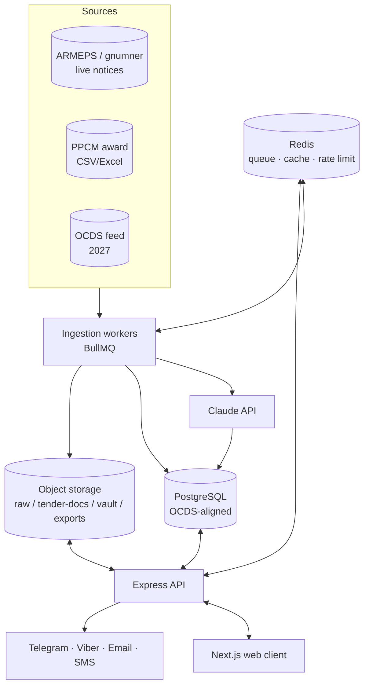
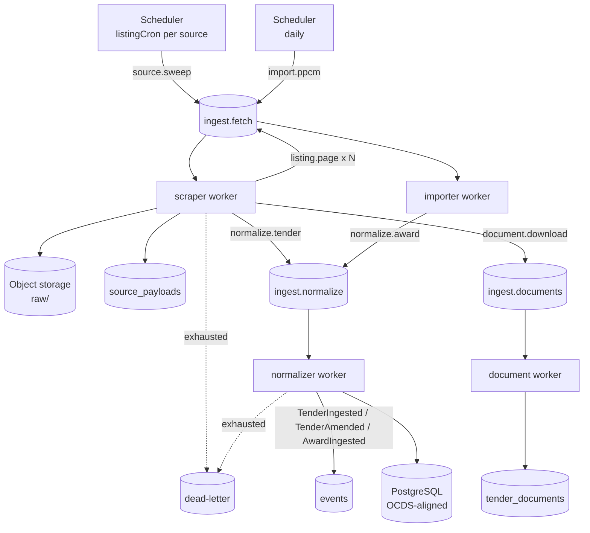

# TenderIQ

> **Bid intelligence for suppliers who bid on public tenders.**
> Armenia first, OCDS-region expansion later.

TenderIQ is a private SaaS tool used **only by suppliers** — the companies that bid on public
tenders. It helps them discover the right tenders, see what competitors won at, prepare
compliant bids, and never miss a deadline. Think *"Bloomberg Terminal for public tenders,"*
sitting on top of the government's public data.

It is **not** a procurement platform and does **not** replace ARMEPS, the Armenian government
e-procurement system. It reads public procurement data at a polite rate, normalizes it into an
OCDS-aligned model, and turns it into something a supplier can act on.

---

## Table of contents

- [Why it exists](#why-it-exists)
- [Product layers](#product-layers)
- [Project status](#project-status)
- [Architecture](#architecture)
- [Tech stack](#tech-stack)
- [Getting started](#getting-started)
- [Scripts](#scripts)
- [Environment variables](#environment-variables)
- [Project structure](#project-structure)
- [Ingestion pipeline](#ingestion-pipeline)
- [Data model](#data-model)
- [Roadmap](#roadmap)
- [Documentation](#documentation)

---

## Why it exists

Public procurement data in Armenia is technically public and practically unusable. Notices live
on a paginated HTML board reaching back to 2017, award history sits in separate CSV/Excel
exports, and nothing connects the two. A supplier who wants to know *"what did the winner
actually charge for this last time?"* has no way to find out without manual archaeology.

TenderIQ does that archaeology once, continuously, for everyone.

Three problems it solves, in order of how much customers care:

1. **Missed tenders.** A relevant notice published on Friday afternoon that nobody saw. This is
   the #1 churn cause, which is why freshness is an SLA and not a best effort.
2. **Blind pricing.** Bidding without knowing the historical winning range for comparable work.
3. **Deadline and compliance chaos.** Certificates expiring, documents missing, spec
   requirements buried in a 40-page PDF.

### Strategic clock

Armenia's new OCDS-based procurement platform launches **2027-01-01** (contract already signed).
The data model is OCDS-aligned from day one so that switching from scraping to the official feed
is an adapter swap, not a rewrite — and so regional expansion reuses the same core.

---

## Product layers

| Layer | Role | What it does |
|---|---|---|
| **Discovery / Monitoring** | the hook | Saved searches, tender list & detail, Telegram/Viber/email alerts, deadline reminders |
| **Intelligence** | the moat | Competitor winning-price history, "similar tenders won at" benchmarks, buyer/supplier profiles |
| **Bid workflow** | the glue | AI spec-to-checklist, document vault with expiry alerts, pipeline/kanban, tasks |
| **Post-award** | retention | Contract tracking, win/loss analysis, exports |

Intelligence is the defensible part. Discovery is what gets a supplier to sign up; intelligence
is what stops them from leaving.

---

## Project status

**Early. Ingestion works end to end; nothing downstream of it exists yet.**

```
source_payloads = 135        tenders = 0        parties = 0        awards = 0
```

Raw ARMEPS notices are being fetched, stored, and provably deduped. They have not yet become
domain entities — `src/workers/normalizer.js` is still empty, and every feature above reads from
`tenders`. That one file is the highest-leverage work in the repo.

| Phase | Scope | State |
|---|---|---|
| 0 — Foundation | repo, config, entrypoints, middleware, auth, health check | ~40% |
| 1 — Ingestion | scraper, importer, normalizer, backfill, freshness | ~45% |
| 2 — Discovery | saved searches, tender API, matcher, notifier | not started |
| 3 — Intelligence | price benchmarks, buyer/supplier profiles | not started |
| 4 — Bid workflow | pipeline, vault, AI checklist, tasks | not started |
| 5 — Accounts & billing | plans, subscriptions, invoices | not started |
| 6 — Post-award & polish | contracts, win/loss, exports, admin | not started |

All 26 tables exist in the database, so phases 2–6 have their **schema**. They have **zero
application code**. Schema is a promise, not progress.

**What is proven to work:** the ARMEPS listing scraper — politeness gate, TLS chain fix, charset
decode, chained pagination, lookback-bounded early stop — plus raw payload retention in object
storage with deterministic content-hash keys, and retry/backoff/DLQ. Idempotency is verified: a
cold start ingested 116 notices over 14 pages; a repeat sweep fetched 1 page, wrote 0 rows, and
enqueued 0 jobs.

**What is known missing:** the normalizer, all auth middleware (empty files), all HTTP routes
(`_initializeApi()` is still commented out in [src/app.js](src/app.js)), the PPCM importer, the
freshness monitor, tests, CI, and the frontend.

A blunt, file-by-file gap analysis lives in [docs/PROJECT_STATUS.md](docs/PROJECT_STATUS.md).
Read it before starting work — it is ordered by what blocks what.

---

## Architecture

**Modular monolith.** One repo, one dependency graph, clear internal seams — chosen over
microservices because a small team pays the coordination cost of services long before it gets
the benefit. The seams that matter (storage port, source adapters, repositories, queue
boundaries) are where `ingestion` and `intelligence` get extracted later, if load ever demands
it.



### Three processes, one codebase

| Process | Entry | Responsibility |
|---|---|---|
| **API** | [src/server.js](src/server.js) → [src/app.js](src/app.js) | HTTP, auth, tenant isolation, business logic |
| **Workers** | [src/workers/index.js](src/workers/index.js) | BullMQ processors: ingestion, AI, notifications |
| **Scheduler** | [src/queues/scheduler.js](src/queues/scheduler.js) | Registers repeatable jobs, then exits |

Splitting workers from the API is deliberate: scraping is the fragile part of the system, and a
parser blowing up on a redesigned page must never affect request handling. They also scale
independently.

The scheduler is a **one-shot** process, not a daemon. BullMQ persists repeatable schedules in
Redis, so run it on deploy and let it exit.

### Layering rules

```
Router → Middleware → Controller → Service → Repository → Knex/PostgreSQL
                                      ↓
Worker (BullMQ) ─────────────────→ same Services
```

| Layer | Does | Never does |
|---|---|---|
| Router | declares paths, attaches middleware | logic |
| Middleware | JWT verify, role + tenant check, Joi validation, rate limit, error mapping | business rules |
| Controller | reads validated input, calls one service, shapes the response | branching logic, DB access |
| Service | business rules, orchestration, transactions, events | HTTP concepts (`req`/`res`) |
| Repository | all Knex access | business rules |
| Worker | job orchestration, retries, storage I/O | duplicate business logic — it calls the same services |

Two rules carry most of the weight:

1. **Only repositories touch the database.** No Knex in services, controllers, or workers.
2. **Only the storage port touches object storage.** Nothing imports the AWS SDK directly — see
   [src/libs/storage/index.js](src/libs/storage/index.js).

### Cross-cutting invariants

- **Tenant isolation.** Every private query is scoped by `organization_id`. That is a repository
  responsibility, not the caller's — cross-tenant denial is a test case, not a convention.
- **Idempotency.** Every worker job and every payment callback is safe to re-run.
- **Honest intelligence.** Below the comparable-count threshold, benchmarks return
  `insufficient_data`. A fabricated number is worse than no number.
- **Source text is data.** Scraped content and tender PDFs never act as instructions to the AI
  layer.

Full detail: [docs/ARCHITECTURE.md](docs/ARCHITECTURE.md).

---

## Tech stack

| Concern | Choice |
|---|---|
| Runtime | Node.js 20+, ESM (`"type": "module"`) |
| API | Express 5 |
| Database | PostgreSQL via **Knex** — query builder + hand-written migrations |
| Queue / cache | Redis + BullMQ (`ioredis`) |
| Object storage | S3-compatible — MinIO in dev, S3/R2 in prod — behind an in-house storage port |
| Scraping | `axios` + `cheerio` + `iconv-lite`, `robots-parser`; Playwright as an optional fallback |
| Documents | `pdf-parse` |
| Validation | `joi` |
| Auth | JWT access/refresh, `bcryptjs` |
| IDs | `@paralleldrive/cuid2`, application-generated |
| Logging | `winston` |
| AI | Anthropic Claude API — spec→checklist extraction, classification, summarization |
| Frontend *(planned)* | Next.js + React + Tailwind CSS |

### Deliberate deviations from the reference spec

Not omissions — decisions, recorded so they are not mistaken for gaps.

| Reference says | TenderIQ does | Why |
|---|---|---|
| Prisma | **Knex** + hand-written migrations | Explicit SQL, no hidden queries; repositories are the only DB layer |
| Zod | **Joi** | Already a dependency |
| Feature-first folders + `container.js` | Layer-first (`utils/`, `repositories/`, `workers/`, `libs/adapters/`) | Fewer moving parts at this size; the seams that matter are intact |

---

## Getting started

### Prerequisites

- **Node.js 20+** (developed on v24)
- **Docker** with Compose — for Redis and MinIO
- **PostgreSQL** — either the bundled container or a hosted instance (currently Neon)

### 1. Install

```bash
git clone https://github.com/Serg0At/TenderIQ.git
cd TenderIQ
npm install
```

Playwright is an **optional** dependency (a fallback for pages that are not server-rendered). If
its browser download fails, installation still succeeds and the HTTP scraper works fine.

### 2. Configure

```bash
cp .env.example .env
```

Then fill in the real values. [src/configs/variables.config.js](src/configs/variables.config.js)
validates configuration at boot and **refuses to start on a missing required key** — a loud
failure at startup instead of a mysterious `undefined` three layers deep.

### 3. Start the backing services

The app itself runs on the host; Compose only provides what it talks to.

```bash
docker compose up -d                       # Redis + MinIO (+ bucket bootstrap)
docker compose --profile local-db up -d    # ...plus a local PostgreSQL
```

Postgres sits behind a profile because `.env` currently points `PSQL_HOST` at Neon. Compose
reads the root `.env` automatically, so the container credentials stay in sync with what the app
loads.

| Service | URL | Notes |
|---|---|---|
| Redis | `localhost:6379` | `appendonly yes`, `maxmemory-policy noeviction` — BullMQ loses jobs silently if a job hash is evicted mid-flight |
| MinIO (S3 API) | `localhost:9000` | matches `S3_ENDPOINT` |
| MinIO console | `localhost:9001` | login with `S3_ACCESS_KEY` / `S3_SECRET_KEY` |
| PostgreSQL | `localhost:5432` | `local-db` profile only |

`minio-init` is a one-shot container that creates the private bucket and exits 0 — seeing it as
`exited` in `docker compose ps` is correct, not a failure.

### 4. Create the schema

```bash
npm run migrate:up      # full OCDS-aligned schema, one transaction
npm run migrate:down    # reverse-dependency-order teardown
```

### 5. Run

Three processes, three terminals:

```bash
npm run dev         # API on http://localhost:5000
npm run worker:dev  # BullMQ processors
npm run scheduler   # register repeatable sweeps, then exit
```

Once the scheduler has run, the ARMEPS sweep fires every 5 minutes. Watch `logs/combined.log` or
the worker's stdout — a routine sweep touches 1–2 pages and writes 0 rows if nothing is new.
That is the idempotency working, not a broken scraper.

> **TLS note:** `gnumner.minfin.am` omits its intermediate certificate, so Node cannot build a
> chain on its own. The PEM in `certs/` is added to the trust store at startup via
> `SCRAPER_EXTRA_CA_DIR`. Do not remove it — every fetch fails verification without it.

---

## Scripts

| Script | Does |
|---|---|
| `npm run dev` | API with nodemon |
| `npm run worker` | Worker process |
| `npm run worker:dev` | Worker with nodemon |
| `npm run scheduler` | Register repeatable jobs in Redis, then exit |
| `npm run migrate:up` | Create the full schema |
| `npm run migrate:down` | Drop all tables in reverse-dependency order |

---

## Environment variables

`.env` is git-ignored. `.env.example` documents the full surface.

### Server

| Variable | Default | Notes |
|---|---|---|
| `NODE_ENV` | `development` | |
| `PORT` | `5000` | |
| `LOG_LEVEL` | `info` | winston level |
| `CORS`, `API_URL`, `CLIENT_URL` | — | origins for the future web client |

### PostgreSQL

| Variable | Default | Notes |
|---|---|---|
| `PSQL_HOST` | `localhost` | |
| `PSQL_PORT` | `5432` | |
| `PSQL_USER` | `postgres` | |
| `PSQL_PASSWORD` | `` | |
| `PSQL_DATABASE` | `tenderiq` | |
| `PSQL_SSL` | `true` | Accepts a boolean **or** Postgres `sslmode` vocabulary (`require`, `prefer`, `verify-ca`, `verify-full`) — which is what Neon and RDS connection strings actually use |

### Redis

| Variable | Default |
|---|---|
| `REDIS_HOST` | `localhost` |
| `REDIS_PORT` | `6379` |
| `REDIS_PASSWORD` | — |
| `REDIS_DB` | `0` |
| `REDIS_TLS` | `false` |

### Object storage

| Variable | Default | Notes |
|---|---|---|
| `STORAGE_DRIVER` | `s3` | `s3` or `local` |
| `S3_ENDPOINT` | — | `http://localhost:9000` for MinIO |
| `S3_REGION` | `us-east-1` | |
| `S3_BUCKET` | `tenderiq` | |
| `S3_ACCESS_KEY` / `S3_SECRET_KEY` | — | also seed the MinIO root user |
| `S3_FORCE_PATH_STYLE` | `true` | required by MinIO |
| `S3_SSE` | `AES256` | set to `none` for MinIO unless KMS is configured |
| `STORAGE_LOCAL_ROOT` | `./.storage` | `local` driver only |

### Auth

| Variable | Default |
|---|---|
| `JWT_ACCESS_SECRET` / `JWT_REFRESH_SECRET` | — |
| `ACCESS_TOKEN_ACTIVE_TIME` | `15m` |
| `REFRESH_TOKEN_ACTIVE_TIME` | `20d` |
| `GOOGLE_CLIENT_ID` / `GOOGLE_CLIENT_SECRET` / `CALLBACK_URL` | — |

### Scraper

| Variable | Default | Notes |
|---|---|---|
| `SCRAPER_USER_AGENT` | `TenderIQBot/1.0 (…)` | Always the declared bot identity |
| `SCRAPER_RESPECT_ROBOTS` | `true` | |
| `SCRAPER_EXTRA_CA_DIR` | `./certs` | PEMs added alongside the system roots |
| `SCRAPER_HTTP_TIMEOUT_MS` | `30000` | |
| `SCRAPER_BROWSER_TIMEOUT_MS` | `60000` | Playwright fallback |
| `SCRAPER_MAX_ATTEMPTS` | `5` | |
| `SCRAPER_BACKOFF_BASE_MS` / `SCRAPER_BACKOFF_MAX_MS` | `2000` / `120000` | |
| `SCRAPER_MAX_LISTING_PAGES` | `200` | Safety ceiling, **not** the depth control — `lookbackHours` is |
| `SCRAPER_MAX_DOCUMENT_BYTES` | `62914560` | 60 MB |
| `SCRAPER_FRESHNESS_SLA_MINUTES` | `15` | |
| `SOURCE_ARMEPS_BASE`, `SOURCE_ARMEPS_CRON`, `SOURCE_PPCM_BASE`, `SOURCE_PPCM_CRON` | see [sources.config.js](src/configs/sources.config.js) | Per-source overrides |

---

## Project structure

```
TenderIQ/
├── certs/                            # extra CA PEMs for the TLS trust store
├── db/
│   ├── knex.js                       # single Knex instance
│   └── migrations/
│       ├── create_table.js           # full OCDS-aligned schema, one transaction
│       └── drop_table.js             # reverse-dependency-order teardown
├── docker-compose.yml                # Redis + MinIO (+ optional Postgres)
├── docs/                             # architecture, status, scraper guides
└── src/
    ├── server.js                     # API process entry
    ├── app.js                        # Express assembly
    ├── configs/
    │   ├── variables.config.js       # env load + validate; refuses to boot on a missing key
    │   ├── knex.config.js            # pg connection + pool
    │   └── sources.config.js         # per-source scraping config
    ├── libs/
    │   ├── redis.js                  # shared ioredis client + options
    │   ├── storage/                  # storage port + s3 / local drivers
    │   └── adapters/
    │       └── source/armeps/        # client.js · listing.parser.js
    ├── middlewares/                  # auth · authorize · rateLimit  (stubs)
    ├── queues/
    │   ├── index.js                  # queue definitions + connection
    │   ├── names.js                  # queue/job name constants — single source of truth
    │   └── scheduler.js              # registers repeatable jobs, then exits
    ├── repositories/                 # all database access
    ├── utils/                        # logger · hash · http · robots · rateLimiter
    └── workers/
        ├── index.js                  # worker process entry
        ├── scraper.js                # ingest.fetch
        ├── importer.js               # PPCM/OCDS import   (stub)
        ├── normalizer.js             # ingest.normalize   (stub)
        └── aiExtractor.js            # ai.extract         (stub)
```

### Where new code goes

| You are writing… | It goes in |
|---|---|
| An HTTP endpoint | `features/<feature>/routes.js` + `controller.js` |
| A business rule | `features/<feature>/service.js` |
| A SQL query | a repository — never inline |
| A parser for a procurement site | `libs/adapters/source/<source>/` |
| A call to any third party | `libs/adapters/<kind>/` — never inline |
| Something two features need | `libs/` or `domain/` — never another feature's internals |
| A background job | `workers/<worker>.js`, calling existing services |
| A queue or job name | `queues/names.js` |
| A table change | a new file in `db/migrations/` |

The target tree — including the `features/` split and the `container.js` composition root — is
laid out in [docs/ARCHITECTURE.md](docs/ARCHITECTURE.md). It grows the current tree rather than
reorganizing it.

---

## Ingestion pipeline

Ingestion is the moat. Everything else is a read model over what this pipeline produces. A
missed tender is the single failure mode customers churn over, so the design optimizes for
**idempotency, raw-payload retention, and freshness alerting** rather than throughput.



### Sources

| Key | Kind | Cadence | Produces |
|---|---|---|---|
| `armeps` | HTML scrape of live notices | `*/5 * * * *` | `tenders`, `tender_documents`, `parties` (buyer) |
| `ppcm` | CSV/Excel export import | `0 3 * * *` | `awards`, `contracts`, `parties` (supplier) |
| `ocds` *(2027)* | OCDS JSON feed | TBD | replaces `armeps` upstream; downstream unchanged |

Each source is a self-contained adapter — when a site changes layout, exactly one parser file
changes.

### Politeness

Before any outbound request the scraper checks, in order:

1. **robots.txt** — fetched once per host, cached in Redis for 24 h, evaluated with
   `robots-parser` against the configured user agent.
2. **Rate limit** — a Redis token bucket keyed `ratelimit:{source}`. An exhausted bucket
   **delays** the job; it does not fail it.
3. **Concurrency** — the BullMQ worker runs at the source's configured concurrency.

The scraper does not rotate user agents, spoof browsers, or bypass access controls. It reads
public pages at a polite rate and identifies itself.

### Dedupe and idempotency

- `source_payloads` carries a composite unique key on `(source, ref, hash)`.
- Object-storage keys are deterministic — `{prefix}/{source}/{id}/{hash}.{ext}` — so a retried
  write is an overwrite, never a duplicate.
- `tenders.source_id` is unique; it is the dedupe anchor for the entire pipeline.

### Queue topology

| Queue | Producer | Priority |
|---|---|---|
| `ingest.fetch` | scheduler, scraper | normal |
| `ingest.documents` | scraper | low |
| `ingest.normalize` | scraper, importer | normal |
| `ai.extract` | user action, events | high for user, low for bulk |
| `notify.dispatch` | matcher, reminder | high |
| `intel.recompute` | `AwardIngested` | low |
| `dead-letter` | any exhausted job | — |

Priority lanes exist so a multi-year historical backfill can never delay a live tender alert.

### Domain events

At-least-once delivery over BullMQ; every consumer is idempotent. Events carry entity IDs and a
minimal payload — consumers read current state rather than trusting the message.

| Event | Producer | Consumers |
|---|---|---|
| `TenderIngested` | normalizer | matcher, intelligence |
| `TenderAmended` | normalizer | matcher, notifier (re-alert with diff) |
| `TenderMatched` | matcher | notifier |
| `AwardIngested` | normalizer / importer | intelligence, workflow |
| `DocumentUploaded` | vault, workflow | aiExtractor |
| `ChecklistReady` | aiExtractor | workflow, notifier |
| `CertificateExpiring` | reminder | notifier |

Full detail, including the two ARMEPS notice types and the known coverage loss on
direct-attachment notices, is in [docs/SCRAPER_WORKFLOW.md](docs/SCRAPER_WORKFLOW.md).
Building a new source adapter: [docs/SCRAPER_BUILD_GUIDE.md](docs/SCRAPER_BUILD_GUIDE.md).

---

## Data model

`db/migrations/create_table.js` creates 26 tables in one transaction.

| Group | Tables |
|---|---|
| Procurement core (OCDS) | `parties`, `tenders`, `awards`, `contracts`, `tender_documents`, `source_payloads` |
| Tenancy & identity | `users`, `organizations`, `roles`, `memberships` |
| Bid workflow | `tracked_tenders`, `bids`, `checklists`, `checklist_items`, `tasks`, `vault_documents` |
| Discovery | `saved_searches` |
| Intelligence | `price_benchmarks`, `buyer_profiles`, `supplier_profiles` |
| Notifications | `notifications`, `alert_deliveries` |
| Billing | `plans`, `subscriptions`, `invoices` |
| Audit | `audit_logs` |

Load-bearing details:

- `tenders.source_id` is **unique** — the dedupe anchor for the whole ingestion pipeline.
- `tenders.version` + `is_latest` implement amendment history; readers filter on `is_latest`.
- `source_payloads` maps `(source, ref, hash)` → an object-storage key, enabling full replay.
- IDs are application-generated CUID2 strings, not database sequences.
- Blobs never live in PostgreSQL — only keys and metadata do.

### Object-storage prefixes

| Prefix | Contents | Access |
|---|---|---|
| `raw/` | source payloads (HTML/CSV/JSON), retained for replay | internal only |
| `tender-docs/` | downloaded tender documents + extracted text | tenant-scoped read |
| `vault/` | customer certificates | tenant-scoped, encrypted |
| `exports/` | generated PDFs and reports | tenant-scoped, expiring links |

Buckets are private. Every read is a time-limited signed URL.

---

## Roadmap

Dependency-ordered — each step unblocks the next.

1. **Normalizer.** Map raw payloads → `tenders` / `parties`, handle amendment versioning
   (`is_latest`, `version`), emit `TenderIngested` / `TenderAmended`. This one file converts 135
   dead payloads into a real inventory.
2. **Freshness monitor.** Compare `lastSuccessfulSweep(source)` against
   `SCRAPER_FRESHNESS_SLA_MINUTES`; alert on zero-block and DLQ depth. Protects what step 1
   built — today a silently broken scraper would go unnoticed.
3. **Phase 0 completion.** Auth middleware, validation, error handler, health check, routes,
   composition root, role/plan seeds. Unblocks any API at all.
4. **PPCM importer + historical backfill.** Award history is what makes intelligence possible.
5. **Discovery.** Saved searches, matcher, notifier, deadline reminders.
6. **Intelligence v1.** Price benchmarks with an `insufficient_data` guard.
7. **Bid workflow v1.** AI checklist, document vault, pipeline.
8. **Accounts & billing.** Annual prepay first.

Also missing and worth adding early: a test runner and a listing-parser fixture test — that is
the one test that catches a gnumner redesign before customers do.

### Primary risk

**Scraper fragility before 2027.** Contained by isolating each source behind an adapter, keeping
raw payloads forever, alerting on zero results rather than only on errors, and designing the
normalization contract so the 2027 OCDS feed is a drop-in replacement.

---

## Documentation

### In this repo

| Document | Contents |
|---|---|
| [docs/ARCHITECTURE.md](docs/ARCHITECTURE.md) | Components, boundaries, layering, folder structure, data model, queue topology, trade-offs |
| [docs/PROJECT_STATUS.md](docs/PROJECT_STATUS.md) | Honest gap analysis against the reference spec, ordered by what blocks what |
| [docs/SCRAPER_WORKFLOW.md](docs/SCRAPER_WORKFLOW.md) | The ingestion pipeline stage by stage, with verified field notes on gnumner |
| [docs/SCRAPER_BUILD_GUIDE.md](docs/SCRAPER_BUILD_GUIDE.md) | How to build a new source adapter |

### Reference specification

The full product and engineering specification — business model, PRD, database, API, security,
AI, testing, deployment, operations, UX — lives in a separate documentation repository
(`gov-tender-monitoring/docs`), organized as:

`business` · `product` · `architecture` · `technical` · `database` · `backend` · `frontend` ·
`api` · `security` · `ai` · `testing` · `deployment` · `operations` · `ux` · `research`

Where that specification and this codebase disagree, the
[deviations table](#deliberate-deviations-from-the-reference-spec) above is the record of which
choice won and why.

---

## License

ISC.
