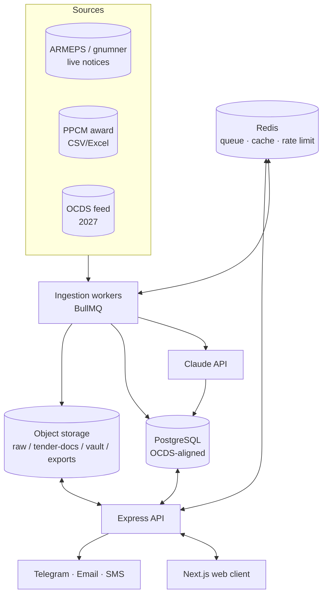
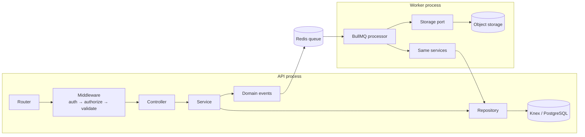

# Tendra — Architectural Design

> Supplier-side bid-intelligence SaaS over public procurement data. Armenia first,
> OCDS-region expansion later.
> Companion document: [SCRAPER_WORKFLOW.md](SCRAPER_WORKFLOW.md).

## Purpose

Describe the system's shape: components and their boundaries, how a request and a job flow
through the layers, and where every kind of code belongs on disk.

---

## Stack

| Concern | Choice |
|---|---|
| Runtime | Node.js, ESM (`"type": "module"`) |
| API | Express 5 |
| Database | PostgreSQL via **Knex** (query builder + hand-written migrations) |
| Queue / cache | Redis + BullMQ (`ioredis`) |
| Object storage | S3-compatible (MinIO in dev, S3/R2 in prod) via an in-house storage port |
| Scraping | `axios` + `cheerio` + `iconv-lite`, Playwright as an optional fallback |
| Documents | `pdf-parse` |
| Validation | `joi` |
| Auth | JWT access/refresh, `bcryptjs` |
| IDs | `@paralleldrive/cuid2`, application-generated |
| Logging | `winston` |
| AI | Claude API (spec → checklist extraction, classification) |

> The upstream reference documentation specifies Prisma. **This codebase uses Knex** — schema
> lives in `migrations/`, data access lives in repositories. Everywhere the reference docs say
> "Prisma client", read "Knex instance"; the layering argument is unchanged.

---

## System context



### Processes

Three deployable processes sharing one codebase:

| Process | Entry | Responsibility |
|---|---|---|
| API | [src/server.js](src/server.js) → [src/app.js](src/app.js) | HTTP, auth, tenant isolation, business logic |
| Workers | `src/workers/index.js` (`npm run worker`) | BullMQ processors: ingestion, AI, notifications |
| Scheduler | `src/queues/scheduler.js` (`npm run scheduler`) | registers repeatable jobs from source crons |

Splitting workers from the API is deliberate: scraping is the fragile part of the system, and a
parser blowing up must never affect request handling. They scale independently.

### Architectural style

**Modular monolith.** One repo, one dependency graph, clear internal seams. Chosen over
microservices because a small team pays the coordination cost of services long before it gets
the benefit. The seams — storage port, source adapters, repositories, queue boundaries — are
where `ingestion` and `intelligence` get extracted later, if load demands it.

**Async ingestion.** Nothing user-facing depends on a source being up. Sources fail, workers
retry, the API serves last-known data.

**OCDS-aligned core.** Entities mirror the Open Contracting Data Standard so the 2027 Armenian
OCDS platform is an adapter swap, not a rewrite, and so regional expansion reuses the model.

---

## Layering



| Layer | Does | Never does |
|---|---|---|
| Router | declares paths, attaches middleware | logic |
| Middleware | JWT verify, role + tenant check, `joi` validation, rate limit, error mapping, request context | business rules |
| Controller | reads validated input, calls one service, shapes the HTTP response | branching business logic, DB access |
| Service | business rules, orchestration, transactions, event emission | HTTP concepts (`req`/`res`) |
| Repository | all Knex access, intention-revealing methods | business rules |
| Worker | job orchestration, retries, storage I/O | duplicate business logic — it calls the same services |

Two rules carry most of the weight:

1. **Only repositories touch the database.** No Knex in services, controllers, or workers.
2. **Only the storage port touches object storage.** Nothing imports the AWS SDK directly —
   see [src/libs/storage/index.js](src/libs/storage/index.js).

### Cross-cutting invariants

- **Tenant isolation.** Every private query is scoped by `organization_id`. This is a repository
  responsibility, not a caller's — cross-tenant denial is a test case, not a convention.
- **Idempotency.** Every worker job and every payment callback is safe to re-run.
- **Honest intelligence.** Below the comparable-count threshold, benchmarks return
  `insufficient_data`. A fabricated number is worse than no number.
- **Source text is data.** Scraped content and tender PDFs never act as instructions to the AI
  layer.

---

## Folder structure

### Current

```
Tendra/
├── ARCHITECTURE.md
├── SCRAPER_WORKFLOW.md
├── package.json
├── .env
├── db/
│   └── migrations/
│       ├── create_table.js          # full OCDS-aligned schema, one transaction
│       └── drop_table.js            # reverse-dependency-order teardown
└── src/
    ├── server.js                    # HTTP bootstrap
    ├── app.js                       # Express assembly: cors, parsers, (routes)
    ├── queue.js                     # BullMQ queues — currently one `ingestion` queue
    ├── configs/
    │   ├── variables.config.js      # env load + validate; refuses to boot if a key is missing
    │   ├── knex.config.js           # pg connection + pool, dev/prod
    │   └── sources.config.js        # per-source scraping adapters config
    ├── libs/
    │   ├── redis.js                 # shared ioredis options + client
    │   └── storage/
    │       ├── index.js             # storage port + deterministic key helpers
    │       ├── s3.storage.js        # S3/MinIO driver
    │       └── local.storage.js     # filesystem driver for dev/tests
    ├── middlewares/
    │   └── auth/
    │       ├── auth.js              # verify JWT, load user + org context   (stub)
    │       ├── authorize.js         # role/permission + tenant check        (stub)
    │       └── rateLimit.js         # Redis-backed limiter                  (stub)
    └── workers/
        ├── scraper.js               # (stub)
        ├── importer.js              # (stub)
        ├── normalizer.js            # (stub)
        └── aiExtractor.js           # (stub)
```

### Target

Grows the current tree rather than reorganizing it — the existing `configs/ libs/ middlewares/
workers/` split stays, and features slot in beside them.

```
Tendra/
├── db/
│   ├── migrations/                  # numbered, forward-only
│   └── seeds/                       # roles, plans, CPV reference data
└── src/
    ├── server.js                    # API process entry
    ├── app.js                       # Express assembly + router mounting
    ├── container.js                 # composition root: build repos → services once
    │
    ├── configs/
    │   ├── variables.config.js
    │   ├── knex.config.js
    │   └── sources.config.js
    │
    ├── libs/
    │   ├── knex.js                  # single Knex instance
    │   ├── redis.js
    │   ├── logger.js                # winston + correlation ID
    │   ├── errors.js                # AppError hierarchy → HTTP mapping
    │   ├── storage/                 # port + s3/local drivers
    │   └── adapters/                # everything external lives behind a port
    │       ├── ai/                  # Claude client, prompt templates, output schemas
    │       ├── notify/              # telegram, email, sms
    │       ├── payment/             # bank transfer, card link
    │       └── source/              # one adapter per procurement source
    │           ├── armeps/          # client.js · listing.parser.js · detail.parser.js
    │           ├── ppcm/            # client.js · csv.parser.js
    │           └── ocds/            # 2027
    │
    ├── domain/
    │   ├── entities/                # OCDS-aligned types, value objects
    │   └── events/                  # TenderIngested, TenderAmended, AwardIngested, …
    │
    ├── middlewares/
    │   ├── auth/                    # auth.js · authorize.js · rateLimit.js
    │   ├── validate.js              # joi schema validation (body/query/params)
    │   ├── requestContext.js        # correlation ID, request-scoped logger
    │   └── error.js                 # central error handler, registered last
    │
    ├── features/                    # one folder per feature; no cross-feature internals
    │   ├── auth/                    # routes.js · controller.js · service.js
    │   ├── orgs/                    #   repository.js · schemas.js · tests/
    │   ├── tenders/
    │   ├── intelligence/
    │   ├── workflow/
    │   ├── vault/
    │   ├── notifications/
    │   ├── billing/
    │   └── ingestion/               # admin: source status, freshness, manual triggers, DLQ
    │
    ├── queues/
    │   ├── index.js                 # queue definitions + connection
    │   ├── names.js                 # queue/job name constants — the single source of truth
    │   └── scheduler.js             # registers repeatable jobs from sources.config.js
    │
    └── workers/
        ├── index.js                 # worker process entry: register all processors
        ├── scraper.js               # ingest.fetch
        ├── importer.js              # ingest.fetch (PPCM/OCDS)
        ├── documents.js             # ingest.documents
        ├── normalizer.js            # ingest.normalize
        ├── aiExtractor.js           # ai.extract
        ├── matcher.js               # saved search matching
        ├── notifier.js              # notify.dispatch
        ├── reminder.js              # schedule.reminders
        └── intelRecompute.js        # intel.recompute
```

#### Placement rules

| You are writing… | It goes in |
|---|---|
| An HTTP endpoint | `features/<feature>/routes.js` + `controller.js` |
| A business rule | `features/<feature>/service.js` |
| A SQL query | `features/<feature>/repository.js` |
| A parser for a procurement site | `libs/adapters/source/<source>/` |
| A call to any third party | `libs/adapters/<kind>/` — never inline |
| Something two features need | `libs/` or `domain/` — never import another feature's internals |
| A background job | `workers/<worker>.js`, calling existing services |
| A queue or job name | `queues/names.js` |
| A table change | a new file in `migrations/` |

The composition root (`container.js`) is the only place that wires repositories into services;
that is what makes services testable with fakes and keeps the dependency direction one-way.

---

## Data model

`migrations/create_table.js` creates the full schema in one transaction. Grouped by concern:

| Group | Tables |
|---|---|
| Procurement core (OCDS) | `parties`, `tenders`, `awards`, `contracts`, `tender_documents`, `source_payloads` |
| Tenancy & identity | `users`, `organizations`, `roles`, `memberships` |
| Bid workflow | `tracked_tenders`, `bids`, `checklists`, `checklist_items`, `vault_documents` |
| Discovery | `saved_searches` |
| Intelligence | `price_benchmarks`, `buyer_profiles`, `supplier_profiles` |
| Notifications | `notifications`, `alert_deliveries` |
| Billing | `plans`, `subscriptions`, `invoices` |
| Audit | `audit_logs` |

Load-bearing details:

- `tenders.source_id` is **unique** — the dedupe anchor for the whole ingestion pipeline.
- `tenders.version` + `is_latest` implement amendment history; readers filter on `is_latest`.
- `source_payloads` maps `(source, ref, hash)` → an object-storage key, enabling replay.
- IDs are application-generated CUID2 strings, not database sequences.
- `organizations.supplier_party_id` → `parties.id` is the **only** bridge between a tenant and
  the public procurement record. Everything else about a tenant is private and joins downward;
  this one joins outward, and it is what makes a customer's own win/loss resolvable against
  `awards` and `public_tender_bids`. Nullable, partial-unique, and claimed explicitly by a
  human — never inferred from a name match.
- Children of a private table take a **composite FK** on `(parent_id, organization_id)` against
  the parent's `UNIQUE (id, organization_id)`, so the denormalised org id cannot drift. Two
  independent foreign keys do not achieve this: Postgres accepted a `bids` row claiming org B
  whose `tracked_tenders` parent belonged to org A. `bids_parent_org_fk` is the pattern.
- **`contracts` is anchored on the tender, not the award.** `award_id NOT NULL` asserted that
  every contract has a separately published award. That is false for single-source and direct
  awards, and inverts OCDS — where a release is keyed by the process (`ocid`, i.e. the tender)
  and `awardID` is a pointer within it. So `contracts` carries `tender_id` (NOT NULL, FK to
  `tenders`) with `award_id` nullable and no single-column FK of its own, anchored by
  `contracts_award_tender_fk` on `(award_id, tender_id)` against `awards_id_tender_uq`.
  `MATCH SIMPLE` makes the composite inert when `award_id` is NULL, which is exactly the
  single-source case; when an award IS named the pair must agree, so a contract cannot claim
  an award from a different tender. `ON DELETE SET NULL (award_id)` takes the column list for
  the same reason `checklist_items` does — a listless composite SET NULL would null
  `tender_id` too and fail its NOT NULL. Applied while the table was empty, which is why
  `tender_id` could be NOT NULL with no backfill; `contracts` still has no writer (phase 6).
- `bids` and `public_tender_bids` are two tables on purpose and must stay that way. `bids` is
  private tenant data that never leaves its tenant; `public_tender_bids` is public record that
  feeds benchmarks published across the whole corpus. Merging them would put a supplier's
  unsubmitted price one WHERE clause away from a competitor's benchmark read.
- Blobs never live in PostgreSQL — only keys and metadata do.

### Object-storage prefixes

| Prefix | Contents | Access |
|---|---|---|
| `raw/` | source payloads (HTML/CSV/JSON), retained for replay | internal only |
| `tender-docs/` | downloaded tender documents + extracted text | tenant-scoped read |
| `vault/` | customer certificates | tenant-scoped, encrypted |
| `exports/` | generated PDFs/reports | tenant-scoped, expiring links |

Buckets are private; every read is a time-limited signed URL. Keys are deterministic
(`{prefix}/{source}/{id}/{hash}.{ext}`) so a retried write is an overwrite, not a duplicate.

---

## Queue topology

| Queue | Producer | Concurrency | Priority |
|---|---|---|---|
| `ingest.fetch` | scheduler, scraper | per-source | normal |
| `ingest.documents` | scraper | low | low |
| `ingest.normalize` | scraper, importer | medium | normal |
| `ai.extract` | user action, events | limited (cost) | high for user, low for bulk |
| `notify.dispatch` | matcher, reminder | high | high |
| `schedule.reminders` | scheduler | medium | normal |
| `intel.recompute` | `AwardIngested` | medium | low |
| `maintenance` | scheduler | low | low |
| `dead-letter` | any exhausted job | — | — |

Priority lanes exist so a historical backfill cannot delay a live tender alert. Details of the
ingestion queues are in [SCRAPER_WORKFLOW.md](SCRAPER_WORKFLOW.md).

---

## Domain events

At-least-once delivery over BullMQ; every consumer is idempotent. Events carry entity IDs and a
minimal payload — consumers read current state rather than trusting the message.

| Event | Producer | Consumers |
|---|---|---|
| `TenderIngested` | normalizer | matcher, intelligence |
| `TenderAmended` | normalizer | matcher, notifier (re-alert with diff) |
| `TenderMatched` | matcher | notifier |
| `AwardIngested` | normalizer / importer | intelligence, workflow (auto win/loss linking) |
| `DocumentUploaded` | vault, workflow | aiExtractor |
| `ChecklistReady` | aiExtractor | workflow, notifier |
| `CertificateExpiring` | reminder | notifier |

---

## Trade-offs and risks

| Decision | Gain | Cost | Mitigation |
|---|---|---|---|
| Modular monolith | speed, one deploy, simple ops | scaling ceiling | seams at storage/adapters/repos; extract later |
| Knex over an ORM | explicit SQL, no hidden queries | manual mapping, no generated types | repositories are the only DB layer; migrations reviewed |
| Redis as both queue and cache | one dependency | shared blast radius | persistence + replication; split instances when it hurts |
| Scraping as primary source | data exists at all pre-2027 | fragile to layout changes | one-file parsers, raw retention, zero-result alerting, OCDS path |
| Separate worker process | failure isolation, independent scaling | extra deploy unit | shared codebase, one container image |
| Precomputed intelligence | fast reads | refresh complexity | event-driven recompute, `insufficient_data` guard |

**Primary architectural risk: scraper fragility before 2027.** Contained by isolating each
source behind an adapter, keeping raw payloads forever, alerting on zero results rather than
only on errors, and designing the normalization contract so the 2027 OCDS feed is a drop-in
replacement.

---

## Known gaps in the current code

Things that will bite before the first end-to-end run:

1. [src/configs/knex.config.js](src/configs/knex.config.js) uses `require()` in an ESM package
   (`"type": "module"`) — it will throw on import. Convert to `import`.
2. Both migration files import `../../configs/knex.config.js` from `migrations/`, which
   resolves outside the repo. The path should be `../../src/configs/knex.config.js`.
3. `package.json` scripts point at `src/workers/index.js` and `src/queues/scheduler.js`; neither
   file exists yet.
4. [src/queue.js](src/queue.js) hardcodes `localhost:6379` instead of using
   `libs/redis.js` `connectionOptions`, and defines only the placeholder `ingestion` queue.
5. `App.init()` calls `this._setCors()` after the constructor already applied a `cors()` layer,
   and `_initializeApi()` is still commented out — no routes are mounted.
6. All worker and auth-middleware files are empty.

---

## References

- [SCRAPER_WORKFLOW.md](SCRAPER_WORKFLOW.md) — ingestion pipeline in detail
- [migrations/create_table.js](migrations/create_table.js) — schema
- [src/configs/variables.config.js](src/configs/variables.config.js) — configuration surface
- [src/libs/storage/index.js](src/libs/storage/index.js) — storage port
