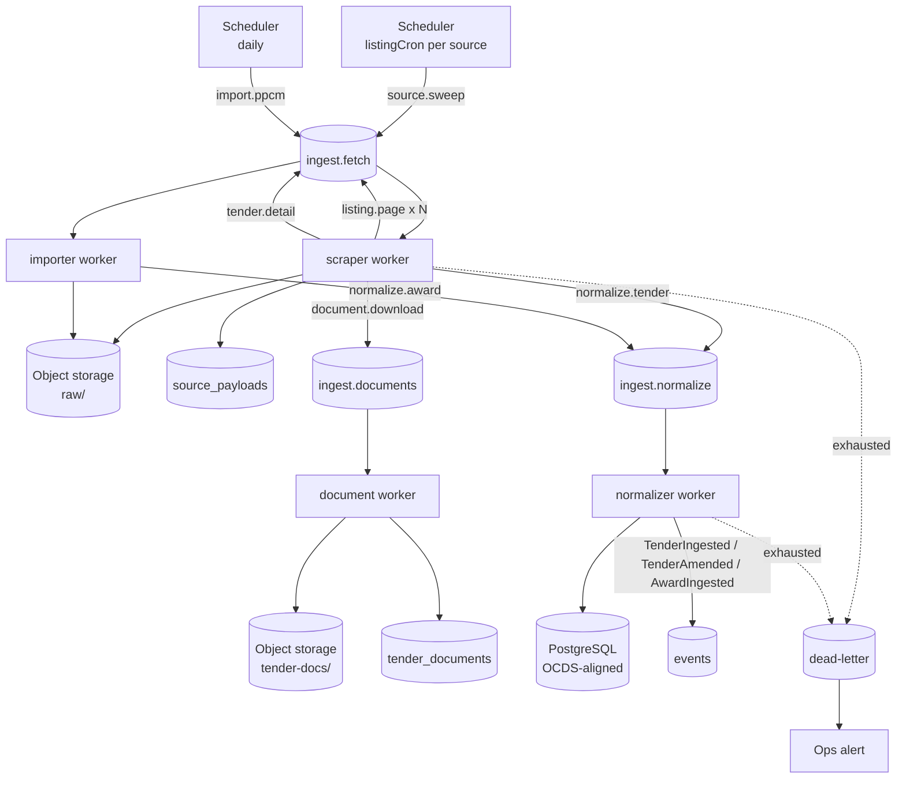
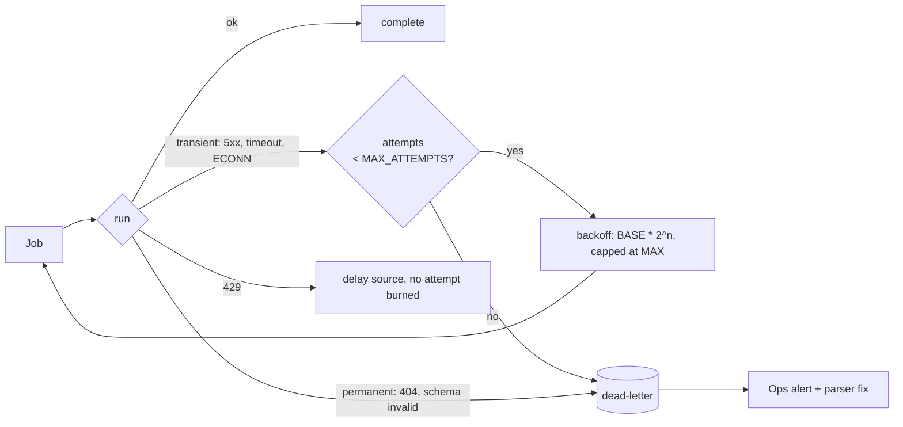

# Scraper Workflow

> How raw public-procurement data becomes normalized, deduped OCDS entities in Tendra.
> Companion document: [ARCHITECTURE.md](ARCHITECTURE.md).

## Purpose

Define the end-to-end ingestion pipeline: what triggers a scrape, what each stage does, where
data lands, how failures are contained, and which knobs control behaviour.

Ingestion is the moat. Everything else in Tendra (discovery, alerts, price intelligence, bid
workflow) is a read model over what this pipeline produces. A missed tender is the single
failure mode customers churn over, so the workflow is designed around **idempotency,
raw-payload retention, and freshness alerting** rather than raw throughput.

---

## Sources

Configured in [src/configs/sources.config.js](src/configs/sources.config.js). Each source is a
self-contained adapter — when a site changes layout, exactly one parser file changes.

| Key | Kind | Cadence | Produces |
|---|---|---|---|
| `eauction` | HTML scrape of eauction board | `*/5 * * * *` sweep, `17 * * * *` result re-check | `tenders`, `parties` (buyer **and** supplier), `awards`, `public_tender_bids` |
| `gnumner` | HTML scrape of the announcement, amendment, contract-concluded and failed-procedure listings, and the files they upload | `*/5 * * * *` sweep, `41 * * * *` paper close-out | `armeps.detail` / `paper.invitation` / `paper.amendment` / `paper.contract` / `paper.failed` jobs and a `gnumner` link on each tender; paper `tenders` (`submission_channel = 'paper'`), buyer and supplier `parties`, `tender_lots`, `tender_documents`, paper `awards` and `public_tender_bids` |
| `armeps` | armeps.am CfT pages, by `resourceId` only — **no listing** | `29 */3 * * *` refresh of every open ARMEPS tender | `tenders` (`submission_channel = 'armeps'`), buyer `parties`, `tender_lots`, `tender_documents` |
| `ppcm` | PPCM's organized-procedures report (JSON behind armeps.am/ppcm), by procedure code — **no listing**, results only | `13 */2 * * *` refresh of ARMEPS tenders past their deadline, not cancelled, with a lot that has neither an award nor a recorded failure | ARMEPS `awards` and `public_tender_bids` (`source = 'ppcm'`), supplier `parties` with their ՀՎՀՀ, a `ppcm` results link, `awarded` |
| `ocds` *(2027)* | OCDS JSON feed | TBD | replaces `eauction` upstream; downstream unchanged |

Per-source knobs: `enabled`, `baseUrl`, `listingCron`, `refreshCron`, `rateLimit`, `concurrency`,
`maxListingPages`, `refreshWindowDays`, `maxRefreshBatch`, `downloadDocuments`; for `ppcm`,
`rateLimitSource` (whose budget it spends), `pollIntervalHours` and the report's ids and columns.

There is deliberately no `lookbackHours` on `eauction`: the eauction listing table has no publish-date
column, so depth is driven by the tid high-water mark instead (stage 3).
Cross-source defaults live under `config.SCRAPER` in
[src/configs/variables.config.js](src/configs/variables.config.js).

---

## Pipeline overview



---

## Stage by stage

### 1. Schedule — `source.sweep`

The scheduler process reads `listEnabledSources()` and registers one BullMQ repeatable job per
source using its `listingCron`. The job ID is derived from the source key, so restarting the
scheduler re-registers rather than duplicates.

A sweep job carries:

```js
{ source: 'eauction', mode: 'incremental', since: <now - lookbackHours>, cursor: null }
```

`mode: 'backfill'` overrides `lookbackHours` with an explicit date range and is enqueued at low
priority so a multi-year backfill never starves live notices.

### 2. Politeness gate

Before any outbound request the scraper checks, in order:

1. **Rate limit** — a Redis token bucket keyed `ratelimit:{source}`, sized from the source's
   `rateLimit: { requests, perMs }`. Exhausted bucket → the job is delayed, not failed.
2. **Concurrency** — the BullMQ worker for a source runs with `concurrency` from its config.

There is no robots.txt check: none of the crawled hosts serves one, and each returns its 404 as an
HTML page rather than a 404 status. Politeness rests entirely on the rate limit plus the honest bot
identity in `SCRAPER.USER_AGENT`. A future source that does publish crawl rules needs this decision
revisited.

Identity is always the declared bot UA (`TendraBot/1.0 (+https://Tendra.am/bot; …)`). The
scraper does not rotate user agents, spoof browsers, or bypass access controls — it reads
public pages at a polite rate and identifies itself.

### 3. Listing sweep — `listing.page`

> **Verified 2026-08-03:** gnumner sends **no `ETag`, no `Last-Modified`, no `Cache-Control`** —
> only `Server: Apache` and a content type. Conditional GET therefore never returns 304 from
> this source. The code still sends the headers (it costs nothing and PPCM may honour them),
> but sweep economy comes entirely from the early-stop rule below, not from 304s.

Pagination is *chained*: each page's handler decides whether to enqueue the next one.

1. HTTP GET via `axios` with `SCRAPER.HTTP_TIMEOUT_MS`, sending `If-None-Match` /
   `If-Modified-Since` when the source supports them.
2. Decode with `iconv-lite` when the response declares a non-UTF-8 charset.
3. Parse rows with `cheerio` → `{ sourceId, url, title, publishedAt, deadlineAt }`.
4. **Two notice types.** The board mixes ARMEPS e-procurement notices (linking to
   `armeps.am/...?resourceId=N`) with direct-attachment notices (a ZIP hosted on gnumner —
   Gazprom Armenia open-offer requests, ministry quotation requests). Only the first kind has a
   stable id; v1 skips the second and *counts* it, so coverage loss is visible rather than
   silent. The parser returns `blocksSeen` and `skipped` alongside `rows` for exactly this.
5. **Continue to page N+1 only while the page's lowest watermark value is still above the
   board's high-water mark, and a next page exists.** One shared chain
   ([src/workers/listingChain.js](../src/workers/listingChain.js)) applies this to every board;
   each source supplies only its page reader, its mark (e-auction: tid; gnumner: publish
   datetime) and its notice → job mapping.
   - The mark is read once by `source.sweep` and carried down the chain with the highest mark
     page 1 saw. Whichever page ends the chain commits that high mark — never earlier, so a chain
     that dies mid-way re-walks the gap.
   - `maxListingPages` bounds a **cold start only** (no watermark yet). With a watermark the chain
     walks until it reaches it — after an outage that is the gap to re-read — bounded only by
     `SCRAPER_MAX_LISTING_PAGES`, and logs a warning naming how far it got if it stops short.
   - "A next page exists" comes from the pager (e-auction's `→` arrow, gnumner's `a.e` link), never
     from the reported page total.
   - A page holding a mark newer than the previous page's oldest throws before it stores, enqueues
     or marks anything healthy (ties are legal): the pager did not advance (a base URL that already contains the listing path does this — the
     site answers with page 1 for every N).

   A routine sweep touches 1–2 pages. Loading history is a deliberate backfill with its own page
   range.
6. Enqueue one job per notice whose fingerprint changed — `tender.detail` for e-auction,
   `armeps.detail` / `paper.invitation` for gnumner — **before** recording the fingerprint. The
   listing writes no domain rows; the detail page is the single writer.

**Browser fallback.** If the parser yields zero rows on a page that returned HTTP 200 and the
markup contains a known JS-app marker, the job re-runs through Playwright with
`SCRAPER.BROWSER_TIMEOUT_MS`. Playwright is an `optionalDependency` — if it is not installed the
job fails loudly rather than silently returning nothing.

### 4. Detail fetch — `tender.detail`

1. Fetch the notice page (same politeness gate).
2. `hash = sha256(body)`.
3. Look up `source_payloads` by `(source, ref)`. **Same hash → stop.** Nothing downstream runs;
   this is the cheap idempotency check that makes the whole pipeline safe to re-run.
4. New or changed → write the body to object storage at
   `rawKey({ source, ref, hash, ext })` → `raw/{source}/{ref}/{hash}.html`.
5. Insert a `source_payloads` row `{ source, ref, storage_key, hash, fetched_at }`.
6. Enqueue `normalize.tender` with `{ source, ref, hash, storageKey }`.
7. If `source.downloadDocuments`, enqueue one `document.download` per attachment link.

Raw payloads are **kept forever**. When a parser improves, normalization is replayed from
storage — no re-crawl of the source.

### 4b. ARMEPS detail — `armeps.detail` and `armeps.documents`

armeps.am has no listing, so a CfT page is fetched only by `resourceId`: from a gnumner notice
(the job carries the notice as `discovery`), or from the refresh. Code:
`libs/adapters/source/armeps/` (client, pure `cft.parser.js`, `observation.js`, pure
`documents.js`) and `workers/armeps.js`.

1. A page that is not a CfT — the site answers an unknown or non-public id with a 200 carrying
   its "you must log in" home page — is **not stored**; the job fails and the failed set is the
   record.
2. **The stored page is canonical, not byte-for-byte.** Every response carries a fresh
   `jsessionid` in its links, a clock, a server-side pager key, and (across days) a calendar and
   a "Last update" date. `canonicalPage` removes exactly those, and that is what is hashed *and*
   stored, so the key's hash is still the sha256 of the bytes behind it and an unchanged tender
   writes nothing. Ref `detail:{resourceId}`, so replay and reindex treat it like any detail page.
3. The normalizer resolves the observation (role `detail`, creates the tender), then resolves the
   gnumner notice it carried (role `discovery`, a pointer to the `resourceId`) onto that tender:
   one tender, two links, never two records. A notice for a page already stored is linked by the
   detail handler itself, since no normalize runs.
4. The page states no status. armeps.am owns "open" and the deadline for the ARMEPS channel, so
   status comes from the deadline (`active` → `closed`); awarded and cancelled are PPCM's and
   gnumner's (ADR 0004). Because a deadline passing changes no page, a refresh that finds the
   page unchanged re-runs normalize over the stored copy (hourly id), and a `closed` that only
   the deadline said reopens when the deadline moves ahead. Documents are queued only for a
   newly stored page or a changed tender, never for a replay or a refresh re-normalize.
5. **Documents are one ZIP** (`downloadCftResourceItems.do`), queued on every normalize under a
   job id carrying the document table's fingerprint — an addendum adds a row without moving any
   field the amendment check reads. The archive is generated per download, with fresh entry
   timestamps and a generated "List of Contract Documents" PDF, so its identity is the hash of
   the buyer's files (path, CRC, size), which names the stored object and dedupes
   `source_payloads` (ref `documents:{resourceId}`). File languages come from the page's own
   HY/EN/RU column. Lots come from the `c4t_*.xml` Tender Structure XML; a tender bought as one
   contract (`num-of-lots="0"`) gets no lots rather than an invented lot 1.
6. **A new document set is an addendum** (ticket 18), for ARMEPS and e-auction alike: see
   *Addendum* under failure scenarios.

**Refresh.** `tender.refresh` is per source. For armeps it re-reads every unsettled ARMEPS tender
whose deadline is ahead or within `refreshWindowDays` behind, stalest link first, as
`armeps.detail` jobs with ids `armeps-refresh-{resourceId}-{hour}` — never `armeps-detail-…`,
so a refresh cannot swallow a discovery. The scheduler registers no sweep for a source without a
listing and removes any `sweep-{source}` left over (e-auction's key was `armeps` until
2026-10-19).

### 4c. Paper invitation — `paper.invitation` and `paper.documents`

A paper tender has no page: the file a gnumner notice uploads (`/website/images/original/…`) is
the whole of it. Code: `libs/adapters/source/gnumner/` (pure `invitation.parser.js`,
`observation.js`, `invitation.files.js`), `services/paperNotice.service.js` and
`workers/paper.js`.

1. The URL is rebuilt from the configured base and the notice's path. A response that is HTML
   (gnumner's 200 for a path it does not have) is **not stored**; the job fails.
2. **Every file is stored**, readable or not, under ref `detail:{sha256 of the bytes}`, with the
   sniffed format as the key's extension. The content hash, not the path, is the identity: a
   buyer sometimes uploads the same file twice under new paths (five byte-identical pairs among
   56 uploads on 2026-10-19/20). The second is one more `discovery` link on the same tender,
   reached by re-normalizing the stored file with that notice, a minute later so the two creates
   do not race.
3. The normalizer reads the file with the notices that listed it: the job's, and on a replay
   those already linked as pointing at that file (`tender_sources.points_to`), each re-read from
   the listing page its `source_payloads` row points at. Not every notice of the tender: once a
   re-post has joined (below) it holds another file's notices too.
   The earliest notice is the publication: the title, the procedure type (the listing's
   `procedureType` in `sources.config.js`) and the publish datetime the deadline is counted from.
4. **The format check** (`invitation.parser.js`): only a `.docx`, or a `.docx` one level inside
   a `.zip`, in which the Armenian announcement template is found, is readable. Everything else
   — `.doc`, `.rar`, `.7z`, `.pdf`, a zip whose Armenian invitation is itself inside a `.rar`, a
   pasted scan — becomes an `unsupported_format` unmatched result and no tender. Counted on
   purpose, and meant to become supported once the counts show which formats matter.
5. From the template: procedure code (`Ընթացակարգի ծածկագիրը`, else the title's), buyer
   (`Պատվիրատուն` …), subject (`կնքել … պայմանագիր`, stored as `description`), submission
   address and deadline (the sentence after «փաստաթղթային ձևով»), and lots from the first
   `Չափաբաժին…` table. A tender with no readable code is created and recorded `no_code`.
6. **The deadline is the Yerevan calendar date of publication + N days, at the stated time**,
   or a date the invitation states. Checked on live notices before it was written (ticket 06):
   the buyer's own listing close is publication + N in 34 of 36; publication + N − 1 and working
   days fit none. A day on a holiday is shown as it is. The listing's close is the fallback when
   the sentence is missing, and a disagreement between the two is logged.
7. `paper.documents` (no request) stores the invitation as the tender's document — the `.zip` as
   it is, a `.docx` wrapped in a one-entry ZIP — lists it and writes the lots, through the same
   `recordDocuments` as the other sources.

**A re-posted invitation joins its run (ticket 07).** A buyer who changes a paper invitation
uploads a new file under the same code, and nothing in it names the old one. So a new file whose
normalized code, channel and buyer match a stored paper tender joins it when the two overlap: the
earlier was still open (deadline ahead, not cancelled or awarded) when the later was published.
Dates, not the stored status, decide, so a replay a month later decides the same.

- The **newer** file is the tender from then on: an amendment (`version + 1`, `amended` while
  open, deadline counted from its own notice), every other current file of the tender superseded
  under the row lock, and one alert, raised by `paper.documents` once the new set can be compared
  with the old (ticket 18). A lock that finds a newer file already committed throws, and the
  retry resolves this one as the older.
- An **older** file read after the newer one — a sweep reads newest first, so a cold start sees
  the re-post first — is a `superseded` link, its notice still linked, and writes nothing else.
- Two runs it could join: created as a new run, with an `ambiguous` unmatched result naming both.
  Once the run has closed or been cancelled, the same code is a re-announcement and a new run.

### 4d. Amendment listing — `paper.amendment`

«Հրավերում կատարված փոփոխություններ» (`listingPaths` entry `kind: 'amendment'`) is swept by the
same chain and watermark as the invitation listings. Its date paragraph carries no `tender_time`
class, and an upload there has no close («…-ից անժամկետ»). ARMEPS links re-read the armeps.am
page at once; e-auction links are counted; uploads become `paper.amendment` jobs:

1. Fetched and stored under ref `amendment:{sha256}`, whatever its format.
2. **Its content is not read, except for a code the title lacks** (decided 2026-10-21): the
   code is the title's; only when the title has none, and the file is a readable `.docx` (or one
   in a `.zip`), is the code read from its body («Ընթացակարգի ծածկագիրը …»); otherwise
   `no_code`. Nothing else is taken from the file. Nearly every one is the Article 29 notice,
   whose reasons are prose; a moved date in it would be a guess — a moved deadline reaches the
   tender through the re-posted invitation. So a `.doc`, `.rar` or `.pdf` attaches like a
   `.docx`, and a notice is never `unsupported_format`; that reason is for files whose content
   Tendra must read (invitations, contract notices).
3. Resolution matches that code across channels: rule 1; no code known → `no_code`; a code held only on e-auction or ARMEPS → skipped (its own source carries the
   amendment); one paper tender announced before the notice and still open when it was
   published → linked (`amendment:{sha256}`, role `discovery`); none → `no_candidate`; two →
   `ambiguous`.
4. `AddendumService.recordNotice` stores the file as the one entry of a ZIP (an archive of files
   as it is) as a `tender_documents` row of kind `amendment` — beside the invitation, never
   compared with it — raises `version`, sets `amended` while open and alerts
   `documentChanges.added: [<file>]`, once: the version moves only when the document row is new.

### 4e. Contract-concluded listing — `paper.contract`

«Կնքված պայմանագրի մասին հայտարարություն» (`listingPaths` entry `kind: 'contract'`, ticket 08)
is the paper channel's results: the only public record of a paper tender's bidders and prices.
Same chain and watermark as the other listings; about 50 notices a day, 6 a page, and every
procedure type files there — ARMEPS, e-auction and single-source procedures too — as uploads. An
ARMEPS link on it is counted and not read (PPCM owns those results). Uploads become
`paper.contract` jobs:

1. Fetched and stored under ref `contract:{digest of the upload path}` — the path, like an
   invitation's notice, not the content, so that a notice left unmatched can be re-read later
   from the listing page it was stored with.
2. **Its content is read** (`contract.parser.js`, template 323-Ա): per lot every bidder's
   name, net price, VAT and total; rejected bids and their reasons; the lot budget; the contract
   (winner, number, date signed, price); and the date the invitation was published. Only the
   Armenian half is read — many notices repeat themselves in Russian, or glue the translation
   onto every cell. A blank VAT cell is a non-VAT payer, whose net is its total. A row that
   cannot be placed in one lot is not read (a lot range «1-47» priced as one; 36 rows numbered
   like the 36 lots that do not belong to them). **The format check** carries the same owner
   comment as the invitation's: only a `.docx` (or one in a `.zip`) holding the price table is
   readable; `.doc`, `.pdf`, `.rar` are `unsupported_format`, counted, and replay from storage
   once a converter exists.
3. The code is the title's, else the body's («… ծածկագրով գնման ընթացակարգի արդյունքում …»).
   Resolution is rule 3 with one addition: the notice names no channel, so the code is looked up
   in every channel, and one held only on e-auction or ARMEPS is skipped — asked before the
   format, so another channel's `.doc` is never counted as an unreadable paper result. Otherwise
   it matches a paper tender on code and the **invitation's** publication day (the notice's
   «Հրավեր ուղարկելու կամ հրապարակելու ամսաթիվը», compared with the tender's `published_at` —
   for a run a re-post joined, with **any** of its files' publications, read back from their
   notices' stored listing pages), with lots that fit; none is `no_candidate`, two `ambiguous`, no code `no_code`. A result
   creates a tender only when its procedure was **never public** (step 6).
   Every unmatched row records the procedure (`procedure_type`) and whether it was public
   (`was_public`: true, false, or null for unknown).
4. `TenderRepository.recordResults`, under the row lock: a `results` link, the lots' bids and
   awards with `source = 'gnumner'` — net into the `*_net` columns, total into the gross ones,
   no rank (a sealed bid list is not a ranking), the award the contract names at the winning
   bid's prices — replacing **only the lots this notice covers**, so two notices for different
   lots both stand. With an award written, the tender becomes `awarded` through `deriveStatus`
   (gnumner owns paper's award), `version + 1`, `TenderAmended`; benchmarks recompute. The
   evaluation table is not a rejection list: a row is a rejection only when a criterion fails.
5. **A later-appearing tender picks it up.** When the normalizer creates a paper tender, or a
   re-posted file joins one, every unresolved `contract:` row of its code (`no_candidate`, `ambiguous`) is queued again as a
   `paper.contract` retry: no request, the notice rebuilt from its stored listing page.
6. **A procedure never announced publicly becomes a result-only tender** (ticket 31). Most
   contract notices are of quotations sent straight to invited suppliers, or of single-source
   purchases: there was never an invitation to miss. `resolution.service.js#wasPublic` decides
   from facts only:
   - an invitation of the code was ever listed on `open` or `quotation` — `listing_notices`, by
     the title's code or, for a title naming none, the code of the tender its link created —
     → **public** (a `no_candidate` here is a tender Tendra missed: the operator alert's row);
   - a single-source procedure (the code's method marker `ՄԱ`, or the notice's procedure row
     citing article 23 — the two must not disagree) → **never public**;
   - otherwise only inside the **covered window**: the invitation's day, and one day either
     side, lies strictly above every invitation listing's **floor** and at or below its
     **watermark**. A cold start sets the floor to the oldest notice it read; a chain that reaches
     the watermark leaves it; a chain stopped by the page ceiling raises it to what it read (the
     hole below is forgotten, not vouched for). Floors live beside the watermarks in Redis
     (`sweep:published:gnumner:{slug}:floor`). Inside the window, with no notice of the code and
     no code-less notice published in that span, → **never public**;
   - anything else (outside the window, an e-auction code, no invitation date) → **unknown**:
     `no_candidate` with `was_public` null, as before.

   A never-public notice with a code, an invitation date, a buyer, a procedure type and an award
   creates a tender of
   its own: `submission_channel = 'paper'`, its procedure type, `awarded`, a `gnumner` link of
   role `results`, `published_at` the invitation's day, and the bids and awards — no deadline,
   CPV, lots or address, because the notice states none. Same lock on the code as a paper
   invitation's create. It is **never biddable and never alerted**: no `match.tender` job is
   queued, now or by a later notice (its status is terminal from the start). A later notice of
   the same procedure joins it by rule 3, its lots not checked (they are only what notices have
   named so far), and a paper invitation never joins it as a re-post. The cold start's depth is
   only `maxListingPages` (five pages of `quotation` were about ten hours on 2026-10-19), so the
   window starts at the first sweep and competitive notices start qualifying a few weeks later,
   once contracts for invitations sent inside it are filed.

### 4f. Failed-procedure listing — `paper.failed`

«Չկայացած գնման ընթացակարգի մասին հայտարարություն» (`listingPaths` entry `kind: 'failed'`,
ticket 09) is the ARMEPS and paper channels' cancellation source (ADR 0004). Same chain and
watermark as the other listings; about ten notices a day, 6 a page, all uploads, e-auctions'
among them. An ARMEPS link on it is counted and not read, as on the contract listing.
Uploads become `paper.failed` jobs:

1. Fetched and stored under ref `failed:{digest of the upload path}`, as a contract notice is.
2. **Its content is read** (`failed.parser.js`, template 235-Ա Annex 13): the table's lot
   numbers, which are **the lots that failed** — not the procedure's. The template's sentence
   ("the procedure is declared failed") is left in place by buyers whose notice lists some lots,
   so it is not read. A row with a blank lot cell is counted and not read. Only the Armenian
   table is read: a `.zip` whose Armenian notice is a `.doc` beside a Russian `.docx` is
   unreadable. `.doc`, `.pdf`, `.rar` and scans are `unsupported_format`, with the owner
   comment, counted under the `failed` kind of the format-count query.
3. The code is the title's, else the body's. Resolution (`resolveFailure`): rule 1; the code
   looked up in every channel, and an e-auction's skipped before the format is asked (held only
   on e-auction, or an `ԷԱՃ` code with no ARMEPS or paper tender); then the ARMEPS or paper
   tender of the code **announced before the notice and past its deadline when the notice was
   published, and of those the latest** — the notice states no invitation date, a failure is
   declared after bids open, and a code is re-announced only after its run failed. Two at one
   moment → `ambiguous`; none → `no_candidate` (a run still open, or with no deadline, is never
   it); lots the notice names that a run lacks rule it out. `was_public` asks only whether the code was ever listed.
   It never creates.
4. `FailureService.recordNotice`, under the row lock: a `results` link with `observed_status
   = 'cancelled'` and `failed_lots` the lots it named. **The tender becomes `cancelled`**
   (`failureStatus`, through `deriveStatus`) **only when its notices, together, name every lot
   it has** (`tender_lots` ∪ the ledger's lots); then `version + 1`, `TenderAmended`, and the
   matcher skips it as `status_cancelled`. A partly failed tender keeps its status. An awarded
   one stays awarded. A tender with no known lots is not cancelled yet.
5. **The lots may come second.** Every document set that writes lots
   (`AddendumService.recordDocuments`, for every source) asks `FailureService.rederive` in the
   same transaction: the tender's stored `failed_lots` against its lots, now. A notice read
   before an ARMEPS archive or a paper tender's `paper.documents` cancels the tender when they
   land — nothing is re-read or re-downloaded. Both sides decide under the row lock from stored
   rows, so whichever comes second decides, and two at once cannot each miss the other.
6. **A later-appearing tender picks it up**, through the contract notice's path: when the
   normalizer creates a paper or ARMEPS tender (or a re-post joins one), `queueResultRetries`
   queues every unresolved `contract:` and `failed:` row of its code as a `reason: 'retry'` job,
   rebuilt from its stored listing page, no request. Resolution decides again.

**Refresh.** A paper file never changes, and its status comes from its deadline, so the gnumner
refresh (`refresh-gnumner`, hourly) re-normalizes from storage — no request — the paper tenders
whose deadline has passed while they still say `active` or `amended`, so they close. It reads the
tender's current file only: a superseded one would write its old deadline back.

### 5. Document download — `document.download`

1. Stream the attachment, aborting past `SCRAPER.MAX_DOCUMENT_BYTES` (60 MB default).
2. `hash = sha256(bytes)` → dedupe: an identical attachment shared by many tenders is stored once.
3. Store at `tenderDocKey({ source, sourceId, hash, ext })` → `tender-docs/{source}/{sourceId}/{hash}.{ext}`.
4. Extract text from PDFs with `pdf-parse`; store alongside at `tenderDocTextKey(...)` (`.txt`).
5. Upsert `tender_documents` `{ tender_id, url, storage_key, kind, parsed }`.
6. Extracted text is the input for the `checklist.extract` (spec → checklist) job; it is treated
   strictly as **data, never as instructions**, no matter what the document says.

#### What is inside the invitation archive — and what is not read

Only `hraver.docx` is opened. That is deliberate, but the reason is worth writing down, because
the archive looks like it holds much more than the stage takes from it. One measured example
(tid 47009, a 15.2 MB archive):

```
    180,247  hraver.docx                      ← the only entry parsed
    140,609  hraver_ru.docx                   ← Russian translation of the same
  2,987,022  lot_1_i_texnikakan_bnutagir.zip  ┐
  2,987,022  lot_2_i_texnikakan_bnutagir.zip  │ "per-lot technical specification"
  2,987,022  lot_3_i_texnikakan_bnutagir.zip  ├ all five are BYTE-IDENTICAL —
  2,987,022  lot_4_i_texnikakan_bnutagir.zip  │ one sha256 across all of them
  2,987,022  lot_5_i_texnikakan_bnutagir.zip  ┘
```

Three findings that would change how anyone approaches these:

- **"Per-lot" is not per-lot.** All five spec archives had one content hash. Parsing them
  per lot would decode the same bytes five times and attribute one document to five different
  lots. Dedupe by content hash first; the lot in the filename is not evidence of lot-specific
  content.
- **98% of the payload is boilerplate.** Inside each: `ՏԲ.docx` at 23 KB — the actual technical
  specification — and `Հուշաթերթ_Памятка_merged.pdf` at 3.1 MB, a generic bilingual memo
  repeated across tenders. The useful content is the small file.
- **The formats vary wildly and include `.rar`.** Across 43 sampled entries: 18 `.xls`,
  11 `.rar`, 11 `.docx`, 3 `.xlsx` (see the header comment in
  `libs/adapters/source/eauction/invitation.parser.js`). `adm-zip` cannot read `.rar`, so roughly
  a quarter of them need a decoder that is not currently a dependency. That, not the parsing,
  is the real cost of this work.

**Status: not built, and nothing reads them.** The parser's header comment says these entries
"feed the later AI checklist" — that is the intent, not the current behaviour. The checklist
stage reads only the `.txt` derived from `hraver.docx`. Wiring the technical specifications in
would sharpen it, and the natural destination is a **lot-level** field, not `tenders.description`.

#### `tenders.description` has no source for e-auction, and is not written for it

A paper invitation (ticket 06) is the one source that states a subject apart from its title —
its notice headline is a long sentence, and the contract-subject line is not a copy of it — so
paper tenders carry it. What follows is about e-auction, and still holds.

For e-auction `normalize.tender` sets it to `null` unconditionally, and `applyInvitationFacts` — the only
other writer — has no parameter for it. The comment beside it in `workers/normalizer.js` pairs
it with `cpvCode` and promises both arrive at "a later stage"; that promise is kept for CPV and
never kept for `description`.

There is no tender-level description to keep it with. Measured on tid 47009: the docx's contract
subject line reads «...կնքել **Անվադողեր** մատակարարման պայմանագիր», and `tenders.title`
(`Վերնագիր` on the detail page) is already `Անվադողեր` — the same string. The detail page has
**11 labels total** and none of them is descriptive. The genuinely descriptive content is per
lot and is already stored in `tender_lots.name` (`"185/65 R15 ձմեռային։"`, `"8.25/R20,
համասեզոնային անվախցիկով (լրակազմ)։"`, ...).

So the column is an OCDS-shaped leftover: everything it could hold is either a duplicate of
`title` or belongs on `tender_lots`. **Open decision — drop it, or leave it null.** Do not fill
it by joining lot names; that is a derived copy of data `tender_lots` already owns.

### 6. Normalization — `normalize.tender` / `normalize.award`

The only stage that writes domain entities. Runs in its own queue so a parser bug can be fixed
and replayed without re-fetching.

1. Read the raw payload from storage by `storageKey`.
2. The source's adapter turns it into an **observation** — one source's view of one tender
   (`libs/adapters/source/<source>/observation.js`). Everything source-specific about
   normalization lives there; `workers/normalizer.js` is an orchestrator and knows no page.
3. **Resolve** it (`services/resolution.service.js`, pure, ADR 0004): an existing
   `(source, external_id)` link wins, then a pointer to another source's id, then — for result
   sources only — normalized procedure code + submission channel + dates and lots. The answer is
   link to a tender, create one, or unmatched. Unmatched goes to `unmatched_results` with its
   reason (`no_candidate`, `ambiguous`, `no_code`, `unsupported_format`) and is counted, never
   guessed onto a tender. A detail source is never matched on its code, so a re-announcement
   under the same code is a second tender.
4. **Derive status** in the same module: only the source that owns a state for the submission
   channel decides it, and status only moves forward.
5. Validate the mapped record with `joi`. Invalid → DLQ with the payload key attached; never a
   partial write. Write the tender, its link and its ledger inside one transaction.
6. **Amendment detection** — compare a canonical field hash (deadline, value, CPV, status, spec
   refs) against the stored latest version:
   - unchanged → touch `fetched_at` only, emit nothing;
   - changed → set previous row `is_latest = false`, insert a new row with `version + 1` and
     `is_latest = true`, emit `TenderAmended` with the field diff.
7. Emit `TenderIngested` (new) or `TenderAmended` (changed) / `AwardIngested`.

Downstream consumers — matcher, notifier, intelligence recompute — are separate workers
subscribed to those events, and are out of scope for this document.

### 7. ARMEPS results — `ppcm.results`

PPCM ("Procurement Plan & Contracts Management", `armeps.am/ppcm`) is an AngularJS app whose
public JSON endpoints carry the ARMEPS channel's results (ticket 10, ADR 0004: PPCM owns
`awarded` for ARMEPS). One report is read: «Կազմակերպված գնման ընթացակարգեր» (organized
procedures), one row per bidder per lot — bidder, ՀՎՀՀ, net offer, the winner, contract price
and dates. Its id, the code parameter's id and the 36 column names are in
`sources.config.js#ppcm.organizedProcedures`; a row is a bare array in that order.

1. **Refresh** (`refresh-ppcm`, every 2 hours): ARMEPS tenders past their deadline, deadline
   within 90 days, not cancelled, and with a lot — its lots or its ledger's — that has neither an
   award nor a failure a notice recorded (`tenders.findAwaitingResults`), oldest first. `awarded`
   arrives with the first lot's contract, and a buyer files the others weeks later, so an
   awarded tender is asked about until every lot is settled.
   PPCM gives nothing whose age says when a tender was last asked about, so each code is claimed
   in Redis (`ppcm:asked:{code}`, `pollIntervalHours` = 24; a failed ask waits out the claim) as the batch (60) is picked: the batch
   rotates through the whole window. Jobs carry `PRIORITY.RESULTS`, behind live discovery.
2. **Ask** (`libs/adapters/source/ppcm/client.js`): the reports page is loaded once for a
   `JSESSIONID`, then `POST /ppcm/public/reports/get-report` with
   `{ reportId, values: [{ paramId, value: "<plain string>" }], page: { index, size }, order: null }`
   — an array `value` is a 400, any other `page` silently caps at 15 rows. Pages of 100 until a
   short one, at most 20. A refused answer (non-zero `status`, or not JSON) renews the session and
   asks once more — an HTTP error status counts as refused too; a fresh session refused again,
   dropped so the retry opens another, is a failure for the job's retry, never another
   page load. The code filter is exact and case-sensitive. Rate limit first: PPCM spends
   armeps.am's budget (`rateLimitSource: 'armeps'`), one host, one allowance.
3. **Store** the pages as received, inside the query (`results:{code}`, `.json`, the code
   exactly as asked — another spelling is another query). An identical answer writes nothing,
   unless the tender asked about still holds no PPCM link: then it is resolved again, so a
   procedure that did not fit before (dates since corrected) attaches without waiting for PPCM's
   rows to change. The payload row is written after the procedures are, so a run that fails
   part-way is read again next time.
4. **Observe** (`ppcm/observation.js`, pure): every row must be of the code asked for, or the
   filter stopped applying and the job fails. Rows are grouped into procedures by announcement
   (a code is re-announced; the id is `{code}@{announced}`), each a `results` observation in the
   ARMEPS channel — an e-auction form is left to eauction's ledger (ticket 11). Per lot: each
   bidder's `participant_total_price` is its **net** offer (no gross is invented); the award is
   the named winner at `contract_price` (**gross**, what the buyer pays) with its own offer as
   net. `bid_rejected` is not read — it is `true` on winning rows. A lot the report joins to
   several contracts keeps the one priced at its winner's own offer, net or + 20% VAT; with none,
   the lot is not read at all — bids without an award would reconcile as the winner's defeat.
5. **Resolve** (rule 3): our code, the ARMEPS channel, announcement = `published_at` day, opening
   = `deadline_at` day, lots that fit, and no disagreement on single source. A miss or two
   candidates is an unmatched result; PPCM never creates a tender.
6. **Write** through `ResultsService.record` — the path a gnumner contract notice takes:
   `tenders.recordResults` (link, bids, awards, status under the row lock), `awarded` through
   `deriveStatus` when a winner is named, the match job, a benchmark recompute. Bidders become
   `ppcm:bo:{ՀՎՀՀ}` parties carrying `tax_id`. A tender PPCM has not reported is untouched, and
   `bids.reconcile` leaves a bid on it `not_found` and retryable. The award's `amount` is the
   contract (spend); a discount from the budget compares the winning offer instead
   (`tender.repo.js#awardOfferSql`), and leaves out and counts a lot whose contract is not it.

`reason: 'replay'` re-records the latest stored answer with no request.

---

## Idempotency model

Every stage is safe to re-run, which is what makes at-least-once queue delivery acceptable.

| Stage | Idempotency key | Effect of a repeat |
|---|---|---|
| `source.sweep` | cron job ID | overlapping sweep is skipped by a Redis lock |
| `listing.page` | `(source, page, etag)` | `304` → no work |
| `tender.detail` | `(source, ref, hash)` | known hash → no storage write, no enqueue |
| `document.download` | content hash | same object key → overwrite-in-place, one DB row |
| `normalize.tender` | `tender_sources (source, external_id)` + field hash | resolves to the same tender; no new version unless fields changed |
| `import.ppcm` | file hash, then award reference | row-level upsert |

Storage keys are deterministic by design: a retried job writes the *same* key, so a partial
failure leaves a correct object rather than a duplicate.

---

## Failure handling



- Attempts and backoff come from `SCRAPER.MAX_ATTEMPTS` (5), `SCRAPER.BACKOFF_BASE_MS` (2 s),
  `SCRAPER.BACKOFF_MAX_MS` (120 s).
- `429` **delays** the source rather than consuming an attempt — being rate-limited is not a job
  failure.
- Schema-invalid records go straight to DLQ with their raw storage key, so the fix is: patch the
  parser, replay from storage.
- DLQ depth is a monitored metric; growth means a source changed shape.

### Freshness monitoring

`SCRAPER.FRESHNESS_SLA_MINUTES` (15) encodes NFR-DATA-1.

> **Correction.** An earlier version of this document said to compare
> `max(source_payloads.fetched_at)` against now. **That is wrong.** Unchanged content is
> deliberately never inserted, so that value reports the last *change*, not the last successful
> *fetch* — a healthy source that simply published nothing for an hour would look dead and page
> someone at 3am. Sweep health is a separate signal: the worker writes a Redis key
> `sweep:ok:{source}` on every successful page, read via `lastSuccessfulSweep(source)`.

The monitor compares that key against now:

| Condition | Severity |
|---|---|
| Lag > SLA | P1 — pipeline is silently broken |
| Sweep returned **zero** rows on a source that normally returns rows | P1 — parser drift |
| DLQ depth rising | P2 |
| Coverage (ingested vs. source-reported count) drops | P1 |

Zero results are the dangerous case: the pipeline "succeeds" while ingesting nothing. That is
why zero-row sweeps alert rather than log.

---

## Configuration reference

| Setting | Where | Default | Controls |
|---|---|---|---|
| `SCRAPER_USER_AGENT` | env | `TendraBot/1.0 …` | bot identity sent on every request |
| `SCRAPER_HTTP_TIMEOUT_MS` | env | `30000` | axios timeout |
| `SCRAPER_BROWSER_TIMEOUT_MS` | env | `60000` | Playwright fallback timeout |
| `SCRAPER_MAX_ATTEMPTS` | env | `5` | retries before DLQ |
| `SCRAPER_BACKOFF_BASE_MS` / `_MAX_MS` | env | `2000` / `120000` | exponential backoff |
| `SCRAPER_MAX_LISTING_PAGES` | env | `200` | global pagination ceiling |
| `SCRAPER_MAX_DOCUMENT_BYTES` | env | `62914560` | attachment size cap |
| `SCRAPER_FRESHNESS_SLA_MINUTES` | env | `15` | freshness alert threshold |
| `rateLimit`, `concurrency`, `lookbackHours`, `maxListingPages`, `downloadDocuments` | `sources.config.js` | per source | per-source politeness and depth |
| `STORAGE_DRIVER` | env | `s3` | `s3` (MinIO/AWS) or `local` for dev |

---

## Operational scenarios

**Source changes layout.** Listing sweep returns zero rows → freshness monitor fires P1 → fix
the one parser file → replay `normalize.tender` from retained raw payloads. No re-crawl, no data
loss, API unaffected.

**Historical backfill.** Enqueue `import.ppcm` with an explicit date range at low priority.
Live `ingest.fetch` and alert dispatch keep their own lanes, so the 5-minute freshness SLA holds
while years of awards load.

**Deadline amendment.** A tender's deadline moves → detail hash changes → normalizer versions
the row (`is_latest` flips) and emits `TenderAmended` → notifier re-alerts everyone tracking it
with the diff.

**Addendum.** The buyer adds, replaces or removes a document and no field moves. The document
stage stores the new set beside the old one, and `services/addendum.service.js` compares the two
file lists (`tender_documents.manifest`: name, CRC, size — never the archive's bytes, which
armeps.am regenerates per download). Any difference raises `version` in the transaction that
writes the new document row, turns `active` into `amended` while the tender is open (an alertable
status, deadline ahead), and queues
`match.tender` with `event: TenderAmended`, `changedFields: []` and `documentChanges` (`added`,
`replaced`, `removed` file names) under the normalizer's `match-{tenderId}-v{version}` id. Past
the deadline, closed, awarded or cancelled, the version is recorded and nothing is queued. A tender's
first set is its documents, not an addendum, and a set whose previous list is unknown raises
nothing (logged). `deriveStatus` keeps `amended` over a page that says "open", or the next
re-normalize would revert it and alert a status change. The previous set is the tender's, not
the archive ref's, so a joined e-auction replacement (below) is compared with its predecessor's.

**e-auction amendments** (ticket 29, ADR 0004). An invitation file is written once at
publication (266 of 266 open tenders, ticket 27), so the addendum rule above never fires for a
tid. An amendment is a **new tid** whose page lists every run it replaced under
«Աճուրդի սկզբնական հրավեր(ներ)»; the old page turns Փոփոխված and leaves the listing. The
replacement's observation carries `supersedes`, resolution joins it to the tender those runs
belong to (rule 2), and `saveNormalized` writes the named runs as `superseded` links in the same
transaction, with no request even for a run never fetched. The join raises `version`, takes its
status from the replacement alone (`amended` while open), and its alert waits for the
replacement's archive: the document job carries `amendment`, compares the new set with the
predecessor's, and raises one `TenderAmended` with `changedFields` and `documentChanges`. A
download that is disabled, already stored, refused or out of attempts raises it without the file
list. Superseded links are sticky and never refreshed, and a page or archive read through one
writes the link and nothing else; a Փոփոխված page no tender links is skipped. The refresh, the
document stage and `documents:backfill` read the **current link**, never `tenders.source_id`.

**What arrives with the archive.** An e-auction page states no CPV; the codes are in the
invitation archive, whose download waits on the politeness budget while the ingest match runs at
once, so that match never sees them. So every document set stored for an **open** tender (alertable
status, deadline ahead) queues a second `match.tender` with `event: TenderIngested`, under
`match-{tenderId}-docs-{sha256(storageKey)[:12]}` — one per stored archive, so a retry reuses the
id and a re-issue gets its own. It is a `tender-match`, since the organizations it adds have never
heard of the tender, and silent for one already alerted (notification dedupe). Whether codes were
there before is deliberately not asked: there is no state for a crash between commit and enqueue
to fall between. Both sources do it; ARMEPS lot names arrive the same way. The ingest match is not
held back for it: that would delay every e-auction alert by the archive queue's wait, and a
download that failed for good would mean no alert at all. Open is the only guard against history,
and it is enough — what `documents:backfill` and the archive seed store is long closed — while an
open tender whose live download `documents:backfill` recovers is exactly the one to alert on.

**Redis outage.** Producers fail fast, queues are durable, workers resume on recovery. The API
keeps serving last-known data from PostgreSQL.

**2027 OCDS migration.** Armenia's OCDS platform launches 2027-01-01. Only the source adapter
and its parser change: raw storage, normalization contract, entities, events, and every
downstream consumer stay as they are.

---

## Current implementation status

| Piece | State |
|---|---|
| `sources.config.js`, `variables.config.js` (SCRAPER/STORAGE) | done |
| Storage port + S3/local drivers, deterministic key helpers | done |
| Schema + composite unique `(source, ref, hash)` on `source_payloads` | done |
| `utils/{logger,hash,http,rateLimiter}.js` | done, verified live |
| e-auction adapter: `listing.parser.js` + `client.js` | done, verified live |
| `repositories/sourcePayload.repo.js` | done |
| `queues/{names,index,scheduler}.js` | done |
| `workers/{scraper,index}.js` — sweep + chained listing pagination | **done, proven idempotent** |
| `importer` / `normalizer` / `aiExtractor` workers | empty stubs |
| Detail-page enrichment (buyer, CPV, value), document download | not started — needs the AJAX endpoints or Playwright |
| Freshness monitor, DLQ alerting | not built — the `sweep:ok:{source}` signal it needs exists |

**Verified end-to-end 2026-08-03** against the live source: cold start ingested 116 notices;
a repeat sweep fetched 1 page, wrote 0 rows and enqueued 0 jobs.

Remaining build order: normalizer (raw → `tenders`/`parties`) → freshness monitor → PPCM
importer → detail enrichment.

---

## References

- [ARCHITECTURE.md](ARCHITECTURE.md) — components, layering, folder structure
- [src/configs/sources.config.js](src/configs/sources.config.js) — per-source adapter config
- [src/libs/storage/index.js](src/libs/storage/index.js) — storage port and key scheme
- [migrations/create_table.js](migrations/create_table.js) — OCDS-aligned schema
