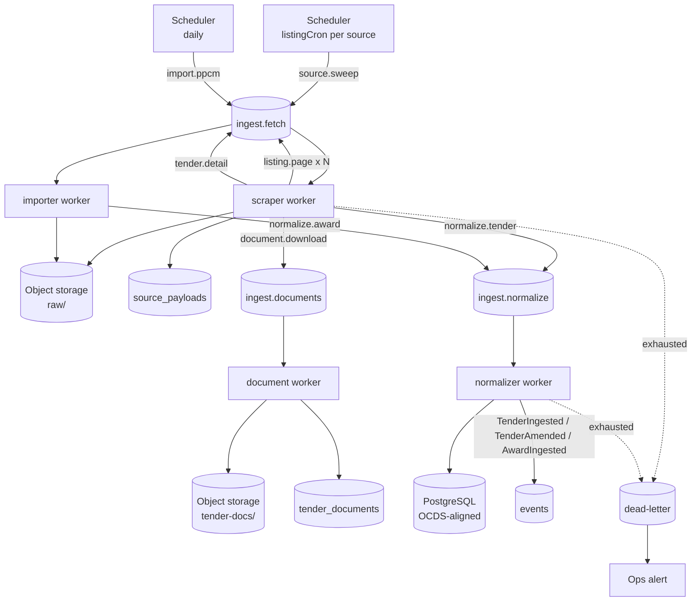
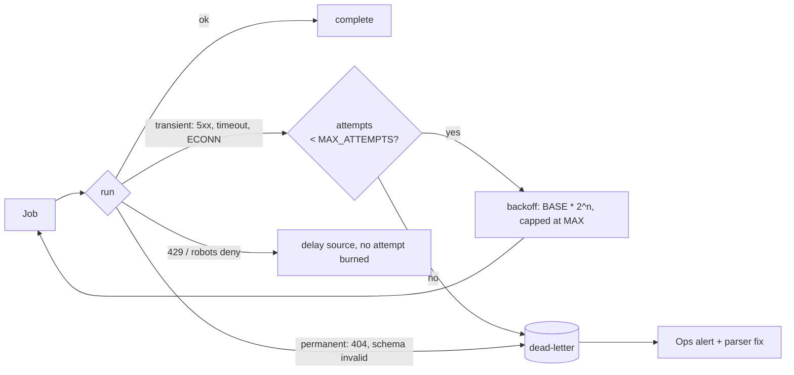

# Scraper Workflow

> How raw public-procurement data becomes normalized, deduped OCDS entities in TenderIQ.
> Companion document: [ARCHITECTURE.md](ARCHITECTURE.md).

## Purpose

Define the end-to-end ingestion pipeline: what triggers a scrape, what each stage does, where
data lands, how failures are contained, and which knobs control behaviour.

Ingestion is the moat. Everything else in TenderIQ (discovery, alerts, price intelligence, bid
workflow) is a read model over what this pipeline produces. A missed tender is the single
failure mode customers churn over, so the workflow is designed around **idempotency,
raw-payload retention, and freshness alerting** rather than raw throughput.

---

## Sources

Configured in [src/configs/sources.config.js](src/configs/sources.config.js). Each source is a
self-contained adapter — when a site changes layout, exactly one parser file changes.

| Key | Kind | Cadence | Produces |
|---|---|---|---|
| `armeps` | HTML scrape of live notices | `*/5 * * * *` | `tenders`, `tender_documents`, `parties` (buyer) |
| `ppcm` | CSV/Excel export import | `0 3 * * *` | `awards`, `contracts`, `parties` (supplier) |
| `ocds` *(2027)* | OCDS JSON feed | TBD | replaces `armeps` upstream; downstream unchanged |

Per-source knobs: `enabled`, `baseUrl`, `listingCron`, `rateLimit`, `concurrency`,
`maxListingPages`, `lookbackHours`, `downloadDocuments`.
Cross-source defaults live under `config.SCRAPER` in
[src/configs/variables.config.js](src/configs/variables.config.js).

---

## Pipeline overview



---

## Stage by stage

### 1. Schedule — `source.sweep`

The scheduler process reads `listEnabledSources()` and registers one BullMQ repeatable job per
source using its `listingCron`. The job ID is derived from the source key, so restarting the
scheduler re-registers rather than duplicates.

A sweep job carries:

```js
{ source: 'armeps', mode: 'incremental', since: <now - lookbackHours>, cursor: null }
```

`mode: 'backfill'` overrides `lookbackHours` with an explicit date range and is enqueued at low
priority so a multi-year backfill never starves live notices.

### 2. Politeness gate

Before any outbound request the scraper checks, in order:

1. **robots.txt** — fetched once per host, cached in Redis (24 h TTL), evaluated with
   `robots-parser` against `SCRAPER.USER_AGENT`. Skipped only if `SCRAPER.RESPECT_ROBOTS=false`.
2. **Rate limit** — a Redis token bucket keyed `ratelimit:{source}`, sized from the source's
   `rateLimit: { requests, perMs }`. Exhausted bucket → the job is delayed, not failed.
3. **Concurrency** — the BullMQ worker for a source runs with `concurrency` from its config.

Identity is always the declared bot UA (`TenderIQBot/1.0 (+https://tenderiq.am/bot; …)`). The
scraper does not rotate user agents, spoof browsers, or bypass access controls — it reads
public pages at a polite rate and identifies itself.

### 3. Listing sweep — `listing.page`

> **Verified 2026-08-03:** gnumner sends **no `ETag`, no `Last-Modified`, no `Cache-Control`** —
> only `Server: Apache` and a content type. Conditional GET therefore never returns 304 from
> this source. The code still sends the headers (it costs nothing and PPCM may honour them),
> but sweep economy comes entirely from the early-stop rule below, not from 304s.

Pagination is *chained*: each page's handler decides whether to enqueue the next one.

1. HTTP GET via `axios` with `SCRAPER.HTTP_TIMEOUT_MS`, sending `If-None-Match` /
   `If-Modified-Since` when the source supports them.
2. Decode with `iconv-lite` when the response declares a non-UTF-8 charset.
3. Parse rows with `cheerio` → `{ sourceId, url, title, publishedAt, deadlineAt }`.
4. **Two notice types.** The board mixes ARMEPS e-procurement notices (linking to
   `armeps.am/...?resourceId=N`) with direct-attachment notices (a ZIP hosted on gnumner —
   Gazprom Armenia open-offer requests, ministry quotation requests). Only the first kind has a
   stable id; v1 skips the second and *counts* it, so coverage loss is visible rather than
   silent. The parser returns `blocksSeen` and `skipped` alongside `rows` for exactly this.
5. **Continue to page N+1 only while the page still holds notices newer than `since`.**
   The board is a 9-year archive reaching back to 2017, so `lookbackHours` — not
   `maxListingPages` — must be the depth control. A routine sweep touches 1–2 pages; a
   post-outage sweep goes as deep as the window requires, with no config change. Loading
   history is a deliberate backfill with its own date range.
6. Enqueue one `normalize.tender` job per row whose fingerprint changed.

**Browser fallback.** If the parser yields zero rows on a page that returned HTTP 200 and the
markup contains a known JS-app marker, the job re-runs through Playwright with
`SCRAPER.BROWSER_TIMEOUT_MS`. Playwright is an `optionalDependency` — if it is not installed the
job fails loudly rather than silently returning nothing.

### 4. Detail fetch — `tender.detail`

1. Fetch the notice page (same politeness gate).
2. `hash = sha256(body)`.
3. Look up `source_payloads` by `(source, ref)`. **Same hash → stop.** Nothing downstream runs;
   this is the cheap idempotency check that makes the whole pipeline safe to re-run.
4. New or changed → write the body to object storage at
   `rawKey({ source, ref, hash, ext })` → `raw/{source}/{ref}/{hash}.html`.
5. Insert a `source_payloads` row `{ source, ref, storage_key, hash, fetched_at }`.
6. Enqueue `normalize.tender` with `{ source, ref, hash, storageKey }`.
7. If `source.downloadDocuments`, enqueue one `document.download` per attachment link.

Raw payloads are **kept forever**. When a parser improves, normalization is replayed from
storage — no re-crawl of the source.

### 5. Document download — `document.download`

1. Stream the attachment, aborting past `SCRAPER.MAX_DOCUMENT_BYTES` (60 MB default).
2. `hash = sha256(bytes)` → dedupe: an identical attachment shared by many tenders is stored once.
3. Store at `tenderDocKey({ source, sourceId, hash, ext })` → `tender-docs/{source}/{sourceId}/{hash}.{ext}`.
4. Extract text from PDFs with `pdf-parse`; store alongside at `tenderDocTextKey(...)` (`.txt`).
5. Upsert `tender_documents` `{ tender_id, url, storage_key, kind, parsed }`.
6. Extracted text is the input for the later `ai.extract` (spec → checklist) job; it is treated
   strictly as **data, never as instructions**, no matter what the document says.

### 6. Normalization — `normalize.tender` / `normalize.award`

The only stage that writes domain entities. Runs in its own queue so a parser bug can be fixed
and replayed without re-fetching.

1. Read the raw payload from storage by `storageKey`.
2. Map source fields → OCDS-aligned entities: `parties` (buyer), `tenders`, and for the importer
   `awards` / `contracts`.
3. Validate the mapped record with `joi`. Invalid → DLQ with the payload key attached; never a
   partial write.
4. **Upsert `tenders` by `source_id`** (unique index) inside a transaction.
5. **Amendment detection** — compare a canonical field hash (deadline, value, CPV, status, spec
   refs) against the stored latest version:
   - unchanged → touch `fetched_at` only, emit nothing;
   - changed → set previous row `is_latest = false`, insert a new row with `version + 1` and
     `is_latest = true`, emit `TenderAmended` with the field diff.
6. Emit `TenderIngested` (new) or `TenderAmended` (changed) / `AwardIngested`.

Downstream consumers — matcher, notifier, intelligence recompute — are separate workers
subscribed to those events, and are out of scope for this document.

### 7. PPCM import — `import.ppcm`

1. Download the daily CSV/Excel export; hash the file.
2. Known file hash → no-op.
3. Store raw under `raw/ppcm/{ref}/{hash}.csv`.
4. Stream rows; the idempotency key per row is `(file-independent award reference)`, so a
   re-published export updates rather than duplicates.
5. Resolve/create supplier and buyer `parties` by tax ID, falling back to normalized name.
6. Upsert `awards` and `contracts`; link to `tenders` by `source_id` when the tender is known,
   otherwise park the award for re-linking on the next tender ingest.
7. Emit `AwardIngested` per award — this drives price-benchmark recompute.

---

## Idempotency model

Every stage is safe to re-run, which is what makes at-least-once queue delivery acceptable.

| Stage | Idempotency key | Effect of a repeat |
|---|---|---|
| `source.sweep` | cron job ID | overlapping sweep is skipped by a Redis lock |
| `listing.page` | `(source, page, etag)` | `304` → no work |
| `tender.detail` | `(source, ref, hash)` | known hash → no storage write, no enqueue |
| `document.download` | content hash | same object key → overwrite-in-place, one DB row |
| `normalize.tender` | `tenders.source_id` + field hash | upsert; no new version unless fields changed |
| `import.ppcm` | file hash, then award reference | row-level upsert |

Storage keys are deterministic by design: a retried job writes the *same* key, so a partial
failure leaves a correct object rather than a duplicate.

---

## Failure handling



- Attempts and backoff come from `SCRAPER.MAX_ATTEMPTS` (5), `SCRAPER.BACKOFF_BASE_MS` (2 s),
  `SCRAPER.BACKOFF_MAX_MS` (120 s).
- `429` and robots denials **delay** the source rather than consuming an attempt — being
  rate-limited is not a job failure.
- Schema-invalid records go straight to DLQ with their raw storage key, so the fix is: patch the
  parser, replay from storage.
- DLQ depth is a monitored metric; growth means a source changed shape.

### Freshness monitoring

`SCRAPER.FRESHNESS_SLA_MINUTES` (15) encodes NFR-DATA-1.

> **Correction.** An earlier version of this document said to compare
> `max(source_payloads.fetched_at)` against now. **That is wrong.** Unchanged content is
> deliberately never inserted, so that value reports the last *change*, not the last successful
> *fetch* — a healthy source that simply published nothing for an hour would look dead and page
> someone at 3am. Sweep health is a separate signal: the worker writes a Redis key
> `sweep:ok:{source}` on every successful page, read via `lastSuccessfulSweep(source)`.

The monitor compares that key against now:

| Condition | Severity |
|---|---|
| Lag > SLA | P1 — pipeline is silently broken |
| Sweep returned **zero** rows on a source that normally returns rows | P1 — parser drift |
| DLQ depth rising | P2 |
| Coverage (ingested vs. source-reported count) drops | P1 |

Zero results are the dangerous case: the pipeline "succeeds" while ingesting nothing. That is
why zero-row sweeps alert rather than log.

---

## Configuration reference

| Setting | Where | Default | Controls |
|---|---|---|---|
| `SCRAPER_USER_AGENT` | env | `TenderIQBot/1.0 …` | bot identity sent on every request |
| `SCRAPER_RESPECT_ROBOTS` | env | `true` | robots.txt enforcement |
| `SCRAPER_HTTP_TIMEOUT_MS` | env | `30000` | axios timeout |
| `SCRAPER_BROWSER_TIMEOUT_MS` | env | `60000` | Playwright fallback timeout |
| `SCRAPER_MAX_ATTEMPTS` | env | `5` | retries before DLQ |
| `SCRAPER_BACKOFF_BASE_MS` / `_MAX_MS` | env | `2000` / `120000` | exponential backoff |
| `SCRAPER_MAX_LISTING_PAGES` | env | `200` | global pagination ceiling |
| `SCRAPER_MAX_DOCUMENT_BYTES` | env | `62914560` | attachment size cap |
| `SCRAPER_FRESHNESS_SLA_MINUTES` | env | `15` | freshness alert threshold |
| `rateLimit`, `concurrency`, `lookbackHours`, `maxListingPages`, `downloadDocuments` | `sources.config.js` | per source | per-source politeness and depth |
| `STORAGE_DRIVER` | env | `s3` | `s3` (MinIO/AWS) or `local` for dev |

---

## Operational scenarios

**Source changes layout.** Listing sweep returns zero rows → freshness monitor fires P1 → fix
the one parser file → replay `normalize.tender` from retained raw payloads. No re-crawl, no data
loss, API unaffected.

**Historical backfill.** Enqueue `import.ppcm` with an explicit date range at low priority.
Live `ingest.fetch` and alert dispatch keep their own lanes, so the 5-minute freshness SLA holds
while years of awards load.

**Deadline amendment.** A tender's deadline moves → detail hash changes → normalizer versions
the row (`is_latest` flips) and emits `TenderAmended` → notifier re-alerts everyone tracking it
with the diff.

**Redis outage.** Producers fail fast, queues are durable, workers resume on recovery. The API
keeps serving last-known data from PostgreSQL.

**2027 OCDS migration.** Armenia's OCDS platform launches 2027-01-01. Only the source adapter
and its parser change: raw storage, normalization contract, entities, events, and every
downstream consumer stay as they are.

---

## Current implementation status

| Piece | State |
|---|---|
| `sources.config.js`, `variables.config.js` (SCRAPER/STORAGE) | done |
| Storage port + S3/local drivers, deterministic key helpers | done |
| Schema + composite unique `(source, ref, hash)` on `source_payloads` | done |
| `utils/{logger,hash,http,robots,rateLimiter}.js` | done, verified live |
| ARMEPS adapter: `listing.parser.js` + `client.js` | done, verified live |
| `repositories/sourcePayload.repository.js` | done |
| `queues/{names,index,scheduler}.js` | done |
| `workers/{scraper,index}.js` — sweep + chained listing pagination | **done, proven idempotent** |
| `importer` / `normalizer` / `aiExtractor` workers | empty stubs |
| Detail-page enrichment (buyer, CPV, value), document download | not started — needs the AJAX endpoints or Playwright |
| Freshness monitor, DLQ alerting | not built — the `sweep:ok:{source}` signal it needs exists |

**Verified end-to-end 2026-08-03** against the live source: cold start ingested 116 notices;
a repeat sweep fetched 1 page, wrote 0 rows and enqueued 0 jobs.

Remaining build order: normalizer (raw → `tenders`/`parties`) → freshness monitor → PPCM
importer → detail enrichment.

---

## References

- [ARCHITECTURE.md](ARCHITECTURE.md) — components, layering, folder structure
- [src/configs/sources.config.js](src/configs/sources.config.js) — per-source adapter config
- [src/libs/storage/index.js](src/libs/storage/index.js) — storage port and key scheme
- [db/migrations/create_table.js](db/migrations/create_table.js) — OCDS-aligned schema
